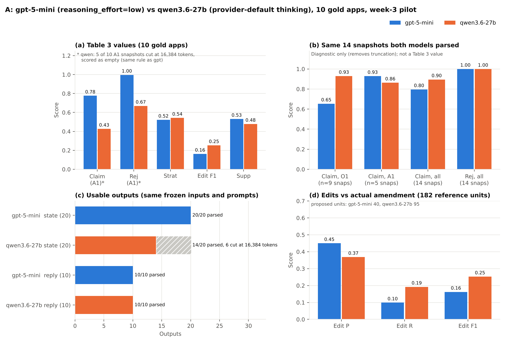

# A — State Tracking + Applicant Response (week-3 pilot)

> **In this repo:** A's part of the week-3 Table 3 pilot (State Tracking: Claim, Rej; Applicant Response: Strat, Edit, Supp).
> Data (`data_v1_share` v1.2, and `data_v0` for the reviewed claim markup) is not in the repo; get it from the shared Drive
> and put it next to this folder (scripts look for `../data_v1_share` and `../data_v0`).
> Not committed: raw model responses / API cache (`outputs/*_raw/`) and the USPTO review PDFs (`gold/pdf/`, list in
> `gold/pdf_needed.txt`, re-download with `scripts/fetch_review_pdfs.py`). The repo `.gitignore` ignores `outputs/`;
> the committed `outputs/*.jsonl|csv` files were added on purpose.
> Summary figure: `results/A_results_plot.pdf` (`python3 a_state_response/scripts/plot_results.py`); intervals: `scripts/bootstrap_ci.py`. Neither needs an API key.
> Language: the human review worksheets in `gold/*.xlsx` (and the sheet names / evidence strings the gold scripts read
> from them, e.g. `integrate_gold.py`, `strategy_evidence.py`) are A's original review records and are partly in Chinese;
> they are kept as-is so the gold can be rebuilt exactly. All final gold, provenance and metrics files are in English.
> Status (10/14): Table 3 values for Claim, Rej, Strat, Edit, Supp are final on the 10 gold apps for GPT-5-mini and for
> Qwen3.6-27B (extra model, see "Qwen3.6-27B run" below). C's reviews are in: Supp judge calibration on 10 units
> (`gold/support_calibration_C_done.csv`) and a check of 3 apps' edit gold (`gold/edits_review_C_done.csv`). Pending: B's review
> of 3 state snapshots (`B_state_review.xlsx`).


## Results and analysis (10 human-reviewed gold apps)
All numbers below are computed from files in this folder (`state_metrics.json`, `response_metrics.json`,
`outputs/state_scores_per_record.csv`, `results/A_bootstrap_ci.json`). 95% intervals are app-level bootstrap
(`scripts/bootstrap_ci.py`, 10,000 draws, seed 20261011). With 10 applications, all intervals are wide; these are pilot results.
The prompt was chosen on 12 dev+tune apps that do not overlap with the 10 gold apps.

| Task | Metric | Value | 95% CI | n |
|---|---|---|---|---|
| State tracking | Claim, O1 cutoff | 0.633 | [0.388, 0.875] | 177 claim records |
| State tracking | Claim, A1 cutoff | 0.777 | [0.573, 0.912] | 340 claim records |
| State tracking | Rej, O1 / A1 cutoff | 1.000 / 0.997 | – | 155 / 155 rejection tuples |
| Applicant response | Strat (macro-F1, 4 labels) | 0.522 | – | 10 replies |
| Applicant response | Edit P / R / F1 | 0.450 / 0.099 / 0.162 | F1 [0.088, 0.239] | 182 ref / 40 pred units |
| Applicant response | Supp | 0.531 (26/49) | – | 53 argument units |

**What the numbers say**
1. **Rej near 1.0 does not show that rejection-status tracking is solved.** In the gold, all 352 rejection and objection tuples at
   the O1 and A1 cutoffs have status `outstanding`: at O1 the rejections were just issued, and the USPTO file-wrapper catalog has
   no examiner document between O1 and the A1 cutoff (`gold/GOLD_README.md`). Rej therefore reduces to (claim, ground) F1 at these
   cutoffs. Testing status changes (withdrawn / overcome / moot) needs a cutoff after a later examiner action.
2. **Claim errors are mostly about versions and status labels, not about finding the claims.** Of 141 wrong claim records, 12 are
   claims missing from the output (all at O1, mainly claims withdrawn after a restriction); the rest are found but have a wrong
   version, status or text. At O1, status is wrong for 32 found records (e.g. `original` instead of `previously_presented`);
   at A1, version is wrong for 52 of 76 wrong records. Text alone fails (similarity < 0.90) for 35 records.
   Details and sourced examples: `state_error_examples.md`.
3. **One application accounts for 57 of the 141 wrong records (14420580).** Claims 1-10 were canceled by a same-day preliminary
   amendment whose cancellation appears only as an image; the model dates the cancellation to the A1 listing, and the version
   error propagates to the claims that amendment added. As a diagnostic only (not a reported score), Claim without this app is
   0.713 (O1) and 0.870 (A1). This concentration is one reason the intervals are wide.
4. **Automatic labels cannot replace the human gold for Claim.** The automatic reference scored against the gold reaches only
   Claim 0.776 (Rej 0.977) (`gold/GOLD_README.md`), so Claim is reported on the 10 gold apps only, not on test_core.
5. **Strategy: frequent labels are easy, rare labels decide the macro-F1.** Per-label F1: amendment 0.889, argument 0.947,
   other 0.250, cancellation 0.000. Cancellation occurs in 2 gold replies; the model predicts it for 3 other replies and
   misses both, so its F1 rests on 5 applications. The supplementary test_core value (0.658, 90 apps) is not comparable: it uses
   automatic labels (whose `argue` label is too loose) and a record-only input.
6. **Edit: the model proposes far fewer changes than applicants made.** 40 predicted vs 182 reference limitation units;
   precision 0.45 [0.23, 0.74], recall 0.10 [0.05, 0.16]. Three applications hold 130 of the 182 reference units
   (13151341, 13575141, 14229448). Edit measures agreement with the applicant's actual amendment, not the legal quality of the
   proposal; a rejection can be answered by different valid amendments, so low recall is expected.
7. **Supp: about half of the cited arguments are supported, and some citations cannot be located.** 26 of 49 cited units are
   supported; for 9 of the 49 (18%) the cited span is not found verbatim (case/punctuation-insensitive) in the cited document;
   4 units carry no citation. Support is judged by GPT-5-mini. On 10 units labelled by C (one per gold app), judge and C agree
   on 6; in all 4 disagreements the judge says `supported` and C says `not_supported`, so the judge is lenient and Supp is
   likely an upper estimate (student labels, not expert validation).
8. **Objections are rarely carried forward.** Objections are excluded from Rej and reported separately: recall 0.667 at O1
   (14 of 21) but 0.048 at A1 (1 of 21), precision 1.0 at both.

Downstream use: D's trajectory forecasting used these predicted A1 states as input; adding them did not improve forecasts on
test_core (difference within noise; `../d_trajectory/results/weekly_summary.md`, section 3).

Data: `data_v1_share/` (same package as everyone). All A files live in this folder (`A/` in the local workspace).

## Files
| file | what |
|---|---|
| `state_schema.json` | JSON schema of a state snapshot (claims entered/proposed, rejections, sources) |
| `state_annotation_guide.md` | how gold snapshots are annotated (statuses, entry rule, edge cases) |
| `inputs/state_inputs.jsonl` | model inputs: dev 3 + gold 10 at O1 and A1 cutoffs, test_core 90 (+ the 10 gold) at A1 cutoff |
| `prompts/state_extraction.txt` | frozen extraction prompt (change it only on dev cases) |
| `scripts/run_state.py` | Azure GPT-5-mini runner with cache and usage log |
| `gold/state_gold_draft.jsonl` | pre-filled gold (20 snapshots) — to be checked |
| `gold/state_gold_review.csv` | 50 rows to check (claim lists + rejection statements) |
| `scripts/score_state.py` | Claim (claim-version accuracy) and Rej (rejection-status macro-F1) |

## Run (Mac terminal or Colab)
```
pip install openai
export AZURE_OPENAI_ENDPOINT="https://<your-resource>.openai.azure.com/openai/v1/"
export AZURE_OPENAI_API_KEY="..."          # never commit or share
export AZURE_DEPLOYMENT="<your gpt-5-mini deployment name>"
python3 a_state_response/scripts/run_state.py --group dev        # Friday: 6 calls, check outputs
python3 a_state_response/scripts/run_state.py --group gold       # 20 calls
python3 a_state_response/scripts/run_state.py --group test_core  # Saturday: 90 calls
python3 a_state_response/scripts/score_state.py                  # after gold/state_gold.jsonl exists
```
Downstream (B, C, D) use the A1_cutoff predictions of test_core + gold = 100 examples in
`outputs/state_predictions.jsonl`.

## Prompt selection (2026-10-09, frozen)
I compared five variants on the dev (3) and tune (9) apps, at both the O1 and A1 cutoffs (24 calls each), against the automatic references (`gold/state_dev_auto_draft.jsonl`):

| variant | Claim O1 | Claim A1 | Rej F1 | cost |
|---|---|---|---|---|
| p1 minimal | 0.640 | 0.578 | 0.885 | $0.39 |
| p1 low | 0.729 | 0.636 | 0.944 | $0.42 |
| p2 minimal | 0.523 | 0.567 | 0.900 | $0.41 |
| p2 low | 0.832 | 0.607 | 0.908 | $0.42 (1 parse failure) |
| **p3 low** | **0.888** | **0.796** | **0.945** | $0.43 |

- **Frozen:** `prompts/state_extraction.txt` = `variants/p3.txt` (hash 829dea35c8), with reasoning effort "low". The previous frozen prompt is kept as `variants/frozen_v0_p1.txt`.
- **What p3 is:** p1 plus a final self-check. The checklist covers the model errors found on dev+tune: preliminary amendments, keeping A1 entered claims equal to the O1 set, carrying version_id for unchanged claims, withdrawn claims after a restriction, expanding claim ranges, and covering every statute in a rejection statement.
- **Remaining disagreements:**
  - The model still sometimes gives a "previously presented" claim the reply's doc_id.
  - Many text "errors" come from the automatic reference: OCR keeps struck-through words in amended claims, and the model's clean text is usually the better one. Human-reviewed gold must fix the text of amended claims.
- **Caveat:** these 12 apps were used for selection, so their scores are optimistic. Report gold and test_core scores only.

## Scoring decision: objections (2026-10-09)
- **Rej** (rejection-status macro-F1) now scores rejections only: 101/102/103/112x/dp. Claim objections (e.g. "objected to as being dependent upon a rejected base claim") are not rejections under 35 U.S.C., so they are left out.
- Objections stay in the schema and are reported separately as `objection_diag` (recall and precision) in `state_metrics.json`. Use `--include-objections` to get the old behaviour.
- On dev+tune (p3_low), Rej is 0.999 without objections and 0.945 with them. Objection recall is 0.28 and precision 0.72: the model mostly omits objections. Report this as a limitation.

## Team model settings (agreed setting for all Table 3 cells)
- `gpt-5-mini` (Azure Global Standard), `reasoning_effort="low"`, `max_completion_tokens=8192` with retries at 16384 and 32768 if the output is cut off (3 of 110 outputs needed 32768), no temperature.
- Log `prompt_hash` and `input_hash` with every output.

## Applicant Response (week 3, 2026-10-10)
Task: from the record up to the O1 mail date plus the predicted O1 state, propose the A1 reply (strategies, edits,
resulting_proposed_claims, arguments with support_doc_id/support_span). No A1 material and no prior-art full text in the input.
- Inputs: `scripts/build_response_inputs.py` -> `inputs/response_inputs.jsonl` (10 gold: record + predicted O1 state; 90 other
  test_core: record only, for supplementary Strat; 3 dev). Leakage check: no input document dated after O1.
- Run: `scripts/run_response.py --group dev|gold|test_core` (gpt-5-mini, low, 8192->16384->32768) -> `outputs/applicant_response.jsonl`.
- Gold: `scripts/build_response_gold.py`
  - Strategy (`gold/response_strategy_gold.csv`): automatic labels checked by A against the A1 documents
    (`gold/response_strategy_review_v2_done.xlsx`, evidence = file + line); 2 of 10 corrected (14239985: no argument,
    interview added; 14420580: no new cancellation). 9 fine labels mapped to the plan's 4: amendment / argument /
    cancellation / other.
  - Edits (`gold/claim_edits_gold.jsonl`): human-reviewed data_v0 claims_markup (`<ins>`/`<del>` tags, checked against page images);
    page headers removed by rule (`scripts/markup_edits.py`); amend/add sets must equal the state gold; cancellations from the state gold.
- Score: `scripts/score_response.py` -> `response_metrics.json`.
  - Strat: macro-F1 over amendment/argument/cancellation/other on the 10 gold apps. Supplementary: 90 test_core apps vs
    automatic labels (note: the automatic 'argue' label is set whenever a REM exists, which is too loose).
  - Edit: limitations = claim text split at ; : wherein/whereby; reference units = added/removed limitations (pre vs post,
    identical tokens = same) + canceled claims; a predicted unit matches at token similarity >= 0.6; micro P/R/F1; no-edit
    replies scored separately (empty-set rule).
  - Supp (changed from the plan, agreed 10/10): span existence by rule (verbatim, case/punctuation-insensitive);
    support by a GPT-5-mini judge (`prompts/support_judge.txt`, `scripts/support_judge.py`); insufficient_evidence = unknown.
    The 53-unit manual first pass was dropped because judging support needs patent/technical expertise; the judge is
    checked on 10 units (seed 20261010, one per gold app) labelled by C (`gold/support_calibration_C_done.csv`, returned
    10/12; A's own labelling was dropped as agreed). `score_response.py` reports C-vs-judge agreement 6/10 with the confusion
    matrix in `response_metrics.json` (`supp_calibration`). The Supp value itself does not change with calibration.
- Results (10 gold): Strat 0.52; Edit P/R/F1 0.45 / 0.10 / 0.16; Supp 0.53 (26/49), coverage 0.92, span found 0.82.
- Cross-review: `B_state_review.xlsx` (B checks 3 gold apps: 13151341, 14229448, 14420580, both cutoffs).
  C checked the edit gold of 13151341, 13575141, 14229448 (`gold/edits_review_C_done.csv`): claim versions and change contents
  confirmed (Y/Y for all 3); the GPT-5-mini edits agree with the actual amendment only partly (2 apps) or not (13151341),
  in line with the low Edit recall. C's notes are in Chinese and kept as-is.

## Qwen3.6-27B run (extra model, 2026-10-14)



Same summary layout as the GPT-5-mini figure: `results/A_results_plot_qwen36_27b.png`. Both figures are rebuilt from the
committed result files without an API key: `python3 a_state_response/scripts/plot_model_comparison.py` and
`python3 a_state_response/scripts/plot_results.py --model qwen`.

Same setting as B and C (`outputs/qwen36_27b/run_config.json`): catalog `qwen--qwen3.6-27b` registry version 4 (non-FP8),
GlobalManagedCompute, 1 x H100 80GB; provider-default thinking and sampling; reasoning_effort, temperature and response_format not
sent (JSON requested by the prompt); max_tokens 8192 with one retry at 16384 on a length cut; 600 s timeout; no transport retries.
Text before an explicit `</think>` and one ```json fence are removed; no other repair.
- Scope: gold 10 only (State 10 x O1/A1 = 20 calls, Response 10 calls), the same frozen inputs and prompts as the GPT-5-mini
  run (`inputs/*.jsonl`, prompt hashes 829dea35c8 / b5ab5de0e7). The Response input keeps the frozen GPT-5-mini predicted O1
  state, as B and C use fixed GPT-derived state. Supp is scored by the same frozen GPT-5-mini judge; C's 10 calibration labels
  belong to the GPT run's argument units and are not applied to Qwen's units.
- Run: `scripts/run_qwen.py --task ping|state|response` (env QWEN_AZURE_ENDPOINT, QWEN_AZURE_API_KEY, QWEN_DEPLOYMENT), then
  `scripts/support_judge.py --pred outputs/qwen36_27b/applicant_response.jsonl --out outputs/qwen36_27b/argument_support_judge.jsonl`,
  `scripts/score_state.py --pred outputs/qwen36_27b/state_predictions.jsonl --out outputs/qwen36_27b/state_metrics.json
  --per-record outputs/qwen36_27b/state_scores_per_record.csv` and `scripts/score_response.py --pred outputs/qwen36_27b/applicant_response.jsonl
  --judge outputs/qwen36_27b/argument_support_judge.jsonl --out outputs/qwen36_27b/response_metrics.json`. Every attempt is in
  `logs/qwen_usage_log.jsonl`; raw responses (with thinking text) are not committed.
- Check before the paid run: feeding GPT-5-mini's own gold outputs through the Qwen parsing and scoring path reproduced the
  GPT-5-mini values exactly.

| Metric | GPT-5-mini | Qwen3.6-27B |
|---|---|---|
| Claim, O1 / A1 cutoff | 0.633 / 0.777 | 0.819 / 0.427 |
| Rej, O1 / A1 cutoff | 1.000 / 0.997 | 0.912 / 0.670 |
| Strat (macro-F1) | 0.522 | 0.542 |
| Edit P / R / F1 | 0.450 / 0.099 / 0.162 | 0.368 / 0.192 / 0.253 |
| Supp | 0.531 (26/49) | 0.478 (11/23) |

**What the numbers say**
1. **Truncation drives Qwen's A1 state scores.** Every state call was cut at 8192 tokens; after the one 16384 retry, 6 of 20
   snapshots were still cut (13151341 O1 and A1; 14239985, 14420580, 14723918, 14838440 at A1) and count as empty predictions,
   the same rule as for GPT-5-mini. All 10 Response calls parsed.
2. **On the snapshots both models parsed, Qwen tracks claims at least as well.** On those 14 snapshots (diagnostic only,
   `outputs/qwen36_27b/state_matched_subset_diagnostic.json`), Claim is 0.895 (Qwen) vs 0.796 (GPT-5-mini): O1 0.930 vs 0.654,
   A1 0.863 vs 0.929. Rej is 1.000 for both, so the Rej gap in Table 3 is truncation.
3. **Qwen proposes more edits.** 95 predicted limitation units vs 40, so recall roughly doubles (0.19 vs 0.10) at lower
   precision (0.37 vs 0.45). It also writes fewer argument units (26 vs 53); 22 of its 23 cited spans are found in the record.
4. With 10 applications and different inference settings (provider-default thinking vs GPT-5-mini low), these are pilot
   observations, not a model ranking.
