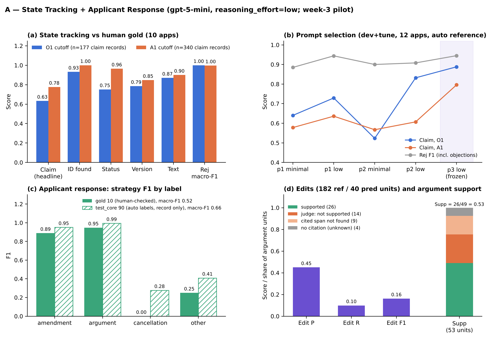

# A — State Tracking + Applicant Response (week-3 pilot)

> **In this repo:** A's part of the week-3 Table 3 pilot (State Tracking: Claim, Rej; Applicant Response: Strat, Edit, Supp).
> Data (`data_v1_share` v1.2, and `data_v0` for the reviewed claim markup) is not in the repo; get it from the shared Drive
> and put it next to this folder (scripts look for `../data_v1_share` and `../data_v0`).
> Not committed: raw model responses / API cache (`outputs/*_raw/`) and the USPTO review PDFs (`gold/pdf/`, list in
> `gold/pdf_needed.txt`, re-download with `scripts/fetch_review_pdfs.py`). The repo `.gitignore` ignores `outputs/`;
> the committed `outputs/*.jsonl|csv` files were added on purpose.
> Summary figure: `results/A_results_plot.pdf` (`python3 a_state_response/scripts/plot_results.py`, no API needed).
> Status (10/11): Table 3 values for Claim, Rej, Strat, Edit, Supp are final on the 10 gold apps. Pending: B's review of
> 3 state snapshots (`B_state_review.xlsx`), A/C Supp judge calibration (`gold/support_calibration_*`).



Data: `data_v1_share/` (same package as everyone). All A files live in this folder (`A/` in the local workspace).

## Files
| file | what |
|---|---|
| `state_schema.json` | JSON schema of a state snapshot (claims entered/proposed, rejections, sources) |
| `state_annotation_guide.md` | how gold snapshots are annotated (statuses, entry rule, edge cases) |
| `inputs/state_inputs.jsonl` | model inputs: dev 3 + gold 10 at O1 and A1 cutoffs, test_core 90 (+ the 10 gold) at A1 cutoff |
| `prompts/state_extraction.txt` | frozen extraction prompt (change it only on dev cases) |
| `scripts/run_state.py` | Azure GPT-5-mini runner with cache and usage log |
| `gold/state_gold_draft.jsonl` | pre-filled gold (20 snapshots) — to be checked |
| `gold/state_gold_review.csv` | 50 rows to check (claim lists + rejection statements) |
| `scripts/score_state.py` | Claim (claim-version accuracy) and Rej (rejection-status macro-F1) |

## Run (Mac terminal or Colab)
```
pip install openai
export AZURE_OPENAI_ENDPOINT="https://<your-resource>.openai.azure.com/openai/v1/"
export AZURE_OPENAI_API_KEY="..."          # never commit or share
export AZURE_DEPLOYMENT="<your gpt-5-mini deployment name>"
python3 a_state_response/scripts/run_state.py --group dev        # Friday: 6 calls, check outputs
python3 a_state_response/scripts/run_state.py --group gold       # 20 calls
python3 a_state_response/scripts/run_state.py --group test_core  # Saturday: 90 calls
python3 a_state_response/scripts/score_state.py                  # after gold/state_gold.jsonl exists
```
Downstream (B, C, D) use the A1_cutoff predictions of test_core + gold = 100 examples in
`outputs/state_predictions.jsonl`.

## Prompt selection (2026-10-09, frozen)
I compared five variants on the dev (3) and tune (9) apps, at both the O1 and A1 cutoffs (24 calls each), against the automatic references (`gold/state_dev_auto_draft.jsonl`):

| variant | Claim O1 | Claim A1 | Rej F1 | cost |
|---|---|---|---|---|
| p1 minimal | 0.640 | 0.578 | 0.885 | $0.39 |
| p1 low | 0.729 | 0.636 | 0.944 | $0.42 |
| p2 minimal | 0.523 | 0.567 | 0.900 | $0.41 |
| p2 low | 0.832 | 0.607 | 0.908 | $0.42 (1 parse failure) |
| **p3 low** | **0.888** | **0.796** | **0.945** | $0.43 |

- **Frozen:** `prompts/state_extraction.txt` = `variants/p3.txt` (hash 829dea35c8), with reasoning effort "low". The previous frozen prompt is kept as `variants/frozen_v0_p1.txt`.
- **What p3 is:** p1 plus a final self-check. The checklist covers the model errors found on dev+tune: preliminary amendments, keeping A1 entered claims equal to the O1 set, carrying version_id for unchanged claims, withdrawn claims after a restriction, expanding claim ranges, and covering every statute in a rejection statement.
- **Remaining disagreements:**
  - The model still sometimes gives a "previously presented" claim the reply's doc_id.
  - Many text "errors" come from the automatic reference: OCR keeps struck-through words in amended claims, and the model's clean text is usually the better one. Human-reviewed gold must fix the text of amended claims.
- **Caveat:** these 12 apps were used for selection, so their scores are optimistic. Report gold and test_core scores only.

## Scoring decision: objections (2026-10-09)
- **Rej** (rejection-status macro-F1) now scores rejections only: 101/102/103/112x/dp. Claim objections (e.g. "objected to as being dependent upon a rejected base claim") are not rejections under 35 U.S.C., so they are left out.
- Objections stay in the schema and are reported separately as `objection_diag` (recall and precision) in `state_metrics.json`. Use `--include-objections` to get the old behaviour.
- On dev+tune (p3_low), Rej is 0.999 without objections and 0.945 with them. Objection recall is 0.28 and precision 0.72: the model mostly omits objections. Report this as a limitation.

## Team model settings (agreed setting for all Table 3 cells)
- `gpt-5-mini` (Azure Global Standard), `reasoning_effort="low"`, `max_completion_tokens=8192` with retries at 16384 and 32768 if the output is cut off (3 of 110 outputs needed 32768), no temperature.
- Log `prompt_hash` and `input_hash` with every output.

## Applicant Response (week 3, 2026-10-10)
Task: from the record up to the O1 mail date plus the predicted O1 state, propose the A1 reply (strategies, edits,
resulting_proposed_claims, arguments with support_doc_id/support_span). No A1 material and no prior-art full text in the input.
- Inputs: `scripts/build_response_inputs.py` -> `inputs/response_inputs.jsonl` (10 gold: record + predicted O1 state; 90 other
  test_core: record only, for supplementary Strat; 3 dev). Leakage check: no input document dated after O1.
- Run: `scripts/run_response.py --group dev|gold|test_core` (gpt-5-mini, low, 8192->16384->32768) -> `outputs/applicant_response.jsonl`.
- Gold: `scripts/build_response_gold.py`
  - Strategy (`gold/response_strategy_gold.csv`): automatic labels checked by A against the A1 documents
    (`gold/response_strategy_review_v2_done.xlsx`, evidence = file + line); 2 of 10 corrected (14239985: no argument,
    interview added; 14420580: no new cancellation). 9 fine labels mapped to the plan's 4: amendment / argument /
    cancellation / other.
  - Edits (`gold/claim_edits_gold.jsonl`): human-reviewed data_v0 claims_markup (<ins>/<del>, checked against page images);
    page headers removed by rule (`scripts/markup_edits.py`); amend/add sets must equal the state gold; cancellations from the state gold.
- Score: `scripts/score_response.py` -> `response_metrics.json`.
  - Strat: macro-F1 over amendment/argument/cancellation/other on the 10 gold apps. Supplementary: 90 test_core apps vs
    automatic labels (note: the automatic 'argue' label is set whenever a REM exists, which is too loose).
  - Edit: limitations = claim text split at ; : wherein/whereby; reference units = added/removed limitations (pre vs post,
    identical tokens = same) + canceled claims; a predicted unit matches at token similarity >= 0.6; micro P/R/F1; no-edit
    replies scored separately (empty-set rule).
  - Supp (changed from the plan, agreed 10/10): span existence by rule (verbatim, case/punctuation-insensitive);
    support by a GPT-5-mini judge (`prompts/support_judge.txt`, `scripts/support_judge.py`); insufficient_evidence = unknown.
    The 53-unit manual first pass was dropped because judging support needs patent/technical expertise; the judge is
    reported as uncalibrated (like the generation Judge) until the calibration is done: the same 10 units (seed 20261010,
    one per gold app) are labelled independently by A (`gold/support_calibration_A_done.xlsx`) and C
    (`gold/support_calibration_C_done.xlsx`); `score_response.py` then reports A-vs-judge, C-vs-judge and A-vs-C agreement.
    The Supp value itself does not change with calibration.
- Results (10 gold): Strat 0.52; Edit P/R/F1 0.45 / 0.10 / 0.16; Supp 0.53 (26/49), coverage 0.92, span found 0.82.
- Cross-review: `B_state_review.xlsx` (B checks 3 gold apps: 13151341, 14229448, 14420580, both cutoffs).
