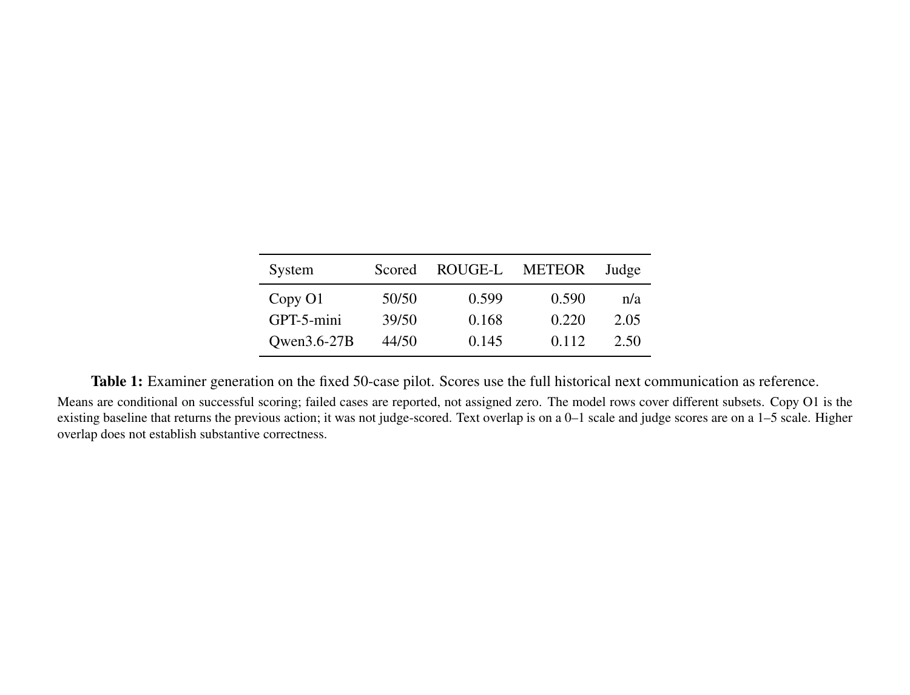
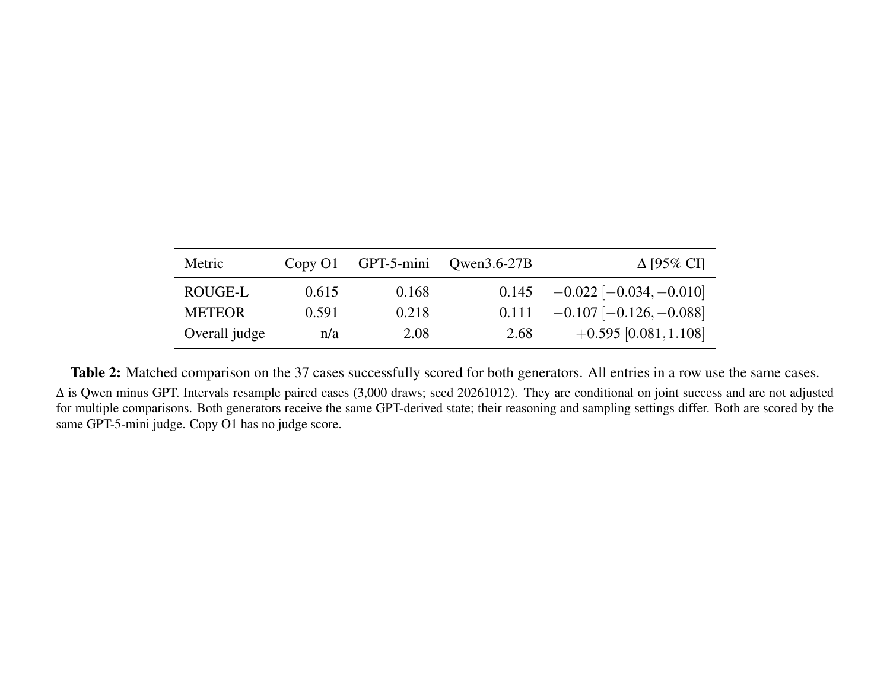
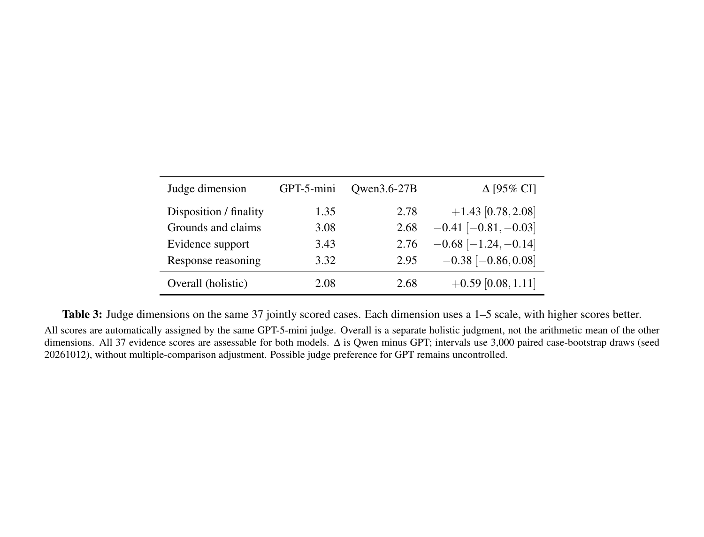
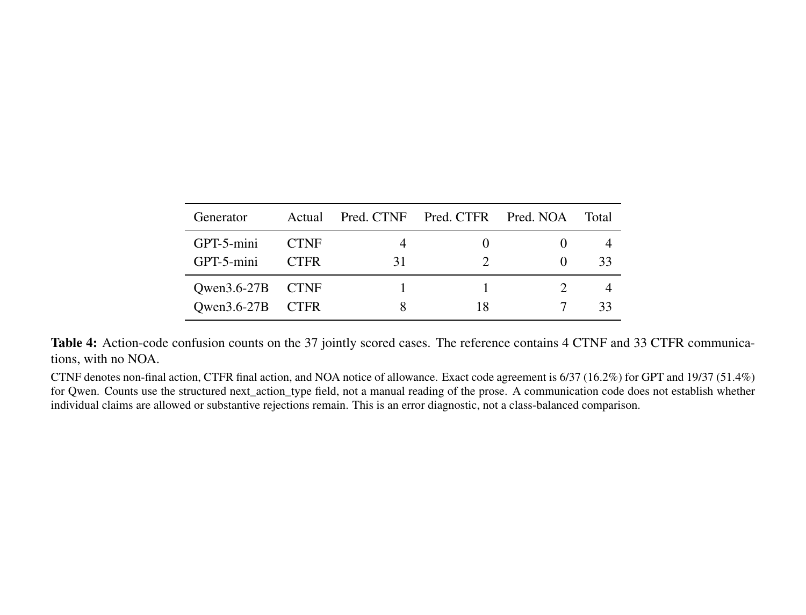
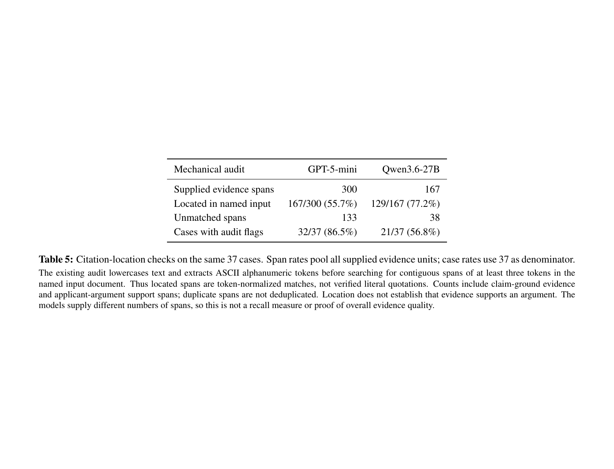
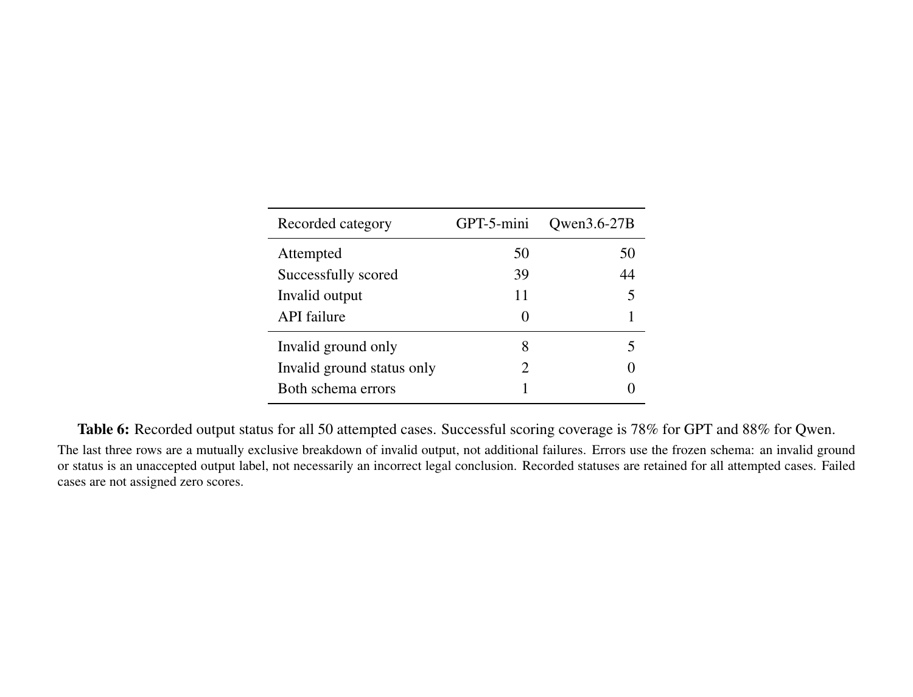

# C examiner generation: additional tables from Week 3

This package reformats the existing GPT-5-mini and Qwen3.6-27B results. It contains **no new model runs, no new examples, and no text-metric rescoring**. Means, counts, and bootstrap intervals are calculated from the saved records. Original predictions, prompts, labels, and statuses are unchanged.

## Main findings

- Both generators attempted the same 50 cases. GPT has 39 scored outputs (78%); Qwen has 44 (88%). Their jointly scored subset contains 37 cases.
- On those 37 cases, GPT has higher ROUGE-L (0.168 vs 0.145) and METEOR (0.218 vs 0.111), while Qwen has a higher overall judge score (2.68 vs 2.08).
- The judge scores Qwen higher on disposition/finality, but lower on grounds, evidence, and response reasoning. The overall score is a separate holistic judgment.
- GPT predicts CTNF on 35/37 matched cases, compared with 9/37 for Qwen and 4/37 in the record. Qwen also predicts nine NOAs although the matched reference has no NOA. These are communication codes, not claim-level allowance labels.
- The existing citation audit locates 167/300 GPT spans and 129/167 Qwen spans after token normalization. These counts do not measure whether an argument is supported.

## Which tables to use

| Table | Purpose | Suggested location |
|---|---|---|
| 01 | Original pilot means, coverage, and existing Copy-O1 baseline | Appendix; omit if Table 3 already covers it |
| 02 | Same-case comparison and paired intervals | Main results |
| 03 | Judge dimension breakdown | Main results or error analysis |
| 04 | Action-code confusion counts | Error analysis |
| 05 | Mechanical evidence-location diagnostic | Appendix |
| 06 | Output failures and schema categories | Appendix |

All six are supplied for selection. They need not all go into the paper.

## Read the denominators correctly

Table 01 preserves the original per-model valid subsets (39 and 44). Tables 02-05 use **exactly the same 37 cases** for both generators. Table 06 uses all 50 attempted cases. Failures are not scored as zero. The 37-case comparison is conditional on joint success and does not establish unconditional quality across the full cohort. There is one application per case.

The full-text metrics compare generated prose with the full historical O2. Copy O1 was already evaluated in Week 3 and is recomputed here only by averaging its saved per-case scores. Its large overlap does not establish that repeating an old action is substantively sound, and no saved judge score exists for that baseline. Substantive-reference metrics are not substituted for full-text scores.

## Protocol and limits

- Data: data_v1 v1.2, fixed `gen_core` cohort, 50 applications. No dev examples are included.
- GPT generator: `gpt-5-mini-2025-08-07`, reasoning `low`, no temperature; 8,192 output-token cap with one 16,384 length retry.
- Qwen generator: `qwen--qwen3.6-27b`, catalog version 4, non-FP8, provider-default thinking/sampling; same output caps. Provider defaults are not equivalent to GPT low reasoning.
- Both use the same fixed GPT-derived A1 state and cutoff-visible inputs. Input and gold files are byte-identical, as are the two prompt files. Model input hashes also match for the common successful cases.
- Judge: the same `gpt-5-mini-2025-08-07` and frozen rubric for both models. Scores are automatic judgments, with possible model preference and limited review. A's separate 10-item support-label calibration is not calibration of these generation scores.
- Overall is not an average of the judge dimensions. All matched evidence dimensions have numeric scores; none is imputed.
- Action counts read the structured `next_action_type` field. CTNF = non-final action, CTFR = final action, NOA = notice of allowance. These labels alone do not establish claim-level allowance or substantive rejection.
- Citation matches use the original audit's lowercasing and ASCII alphanumeric token normalization. They are **not literal-quotation verification, support judgments, or citation recall**. Repeated spans remain repeated units.
- Paired intervals use 3,000 case-bootstrap draws, seed 20261012. Table 02 reproduces the saved Week 3 intervals exactly. Table 03 applies the same postprocessing to the saved dimension scores. These are descriptive pilot intervals, conditional on the observed subset, without multiple-comparison adjustment.
- No cost or latency comparison is made: Qwen GPU-time billing and GPT token billing are not comparable from these files alone.

## Files

- `tables/`: six editable LaTeX `table*` fragments. Only `booktabs` is required.
- `csv/`: one numeric CSV per table, without rounded source values.
- `data/cases.csv`: compact, 50-row derived source table, including status, hashes, saved scores, structured action types, and citation counts. No patent document text, credentials, or endpoint URLs are copied.
- `data/source_manifest.json`: archive/member SHA-256 hashes, original metric summaries, settings, and postprocessing specification.
- `data/verification.json`: reconciliation checks and code agreement.
- `data/analysis_summary.json`: full-precision aggregated values.
- `previews/`: six PNG previews generated from the LaTeX PDF.
- `tables_preview.pdf`: readable preview of the exact LaTeX tables, one per page.
- `tables_preview.tex`: standalone preview source.
- `all_tables.tex`: optional include file for all six tables.
- `paper_results_paragraph.tex`: optional short results paragraph for adaptation.
- `scripts/build_tables.py`: standard-library-only table builder. It imports no model SDK and makes no network calls.
- `UPLOAD_GUIDE_CN.md`: GitHub and Overleaf instructions.

## Rebuild without original archives

From this directory:

```bash
python scripts/build_tables.py
```

This reads the bundled derived CSV and source manifest and regenerates the six LaTeX/CSV tables. It does not run experiments or recalculate ROUGE/METEOR from text.

If `pdflatex` and `pdftoppm` are installed:

```bash
python scripts/build_tables.py --compile-preview
```

To derive the same source rows directly from the original submission archives:

```bash
python scripts/build_tables.py \
  --gpt-zip /path/to/C_gpt5mini_Week3_Submission.zip \
  --qwen-zip /path/to/C_Qwen36_Week3_Submission.zip \
  --compile-preview
```

The archive route checks IDs, input/prompt equality, paired input hashes, judge-to-candidate linkage, original metric means, duplicated GPT baseline scores, and the saved paired intervals. The bundled data route preserves the resulting checks and rechecks aggregate consistency.

## Overleaf

Upload this directory as `C_Week4_Tables/` at the paper root. Add `\usepackage{booktabs}` to the preamble if needed. At the desired point in the results section:

```latex
\input{C_Week4_Tables/tables/t02_paired_comparison}
\input{C_Week4_Tables/tables/t03_judge_dimensions}
\input{C_Week4_Tables/tables/t04_action_confusion}
```

The fragments use `table*` for a two-column paper. Floats may move to the next page; do not put them inside another `table` environment. Table labels are `tab:cgen-t01` through `tab:cgen-t06`. Each table can be included independently. To include all six, use `\input{C_Week4_Tables/all_tables}` instead of the individual inputs. Renumbering is automatic. Do not manually name them Table 4/5/6.

## Preview

### t01_pilot_summary: Pilot results and scoring coverage

[LaTeX](tables/t01_pilot_summary.tex) | [CSV](csv/t01_pilot_summary.csv)



### t02_paired_comparison: Comparison on the same 37 cases

[LaTeX](tables/t02_paired_comparison.tex) | [CSV](csv/t02_paired_comparison.csv)



### t03_judge_dimensions: Where the judge scores differ

[LaTeX](tables/t03_judge_dimensions.tex) | [CSV](csv/t03_judge_dimensions.csv)



### t04_action_confusion: Predicted action types versus the record

[LaTeX](tables/t04_action_confusion.tex) | [CSV](csv/t04_action_confusion.csv)



### t05_citation_audit: Mechanical evidence-location audit

[LaTeX](tables/t05_citation_audit.tex) | [CSV](csv/t05_citation_audit.csv)



### t06_output_failures: Output validity and failure categories

[LaTeX](tables/t06_output_failures.tex) | [CSV](csv/t06_output_failures.csv)


