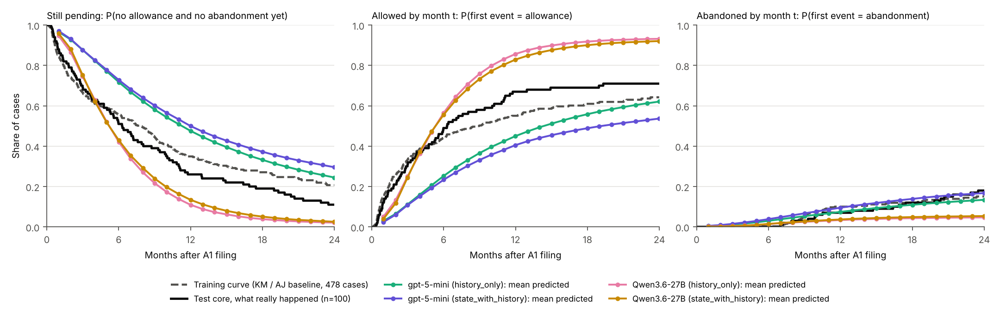
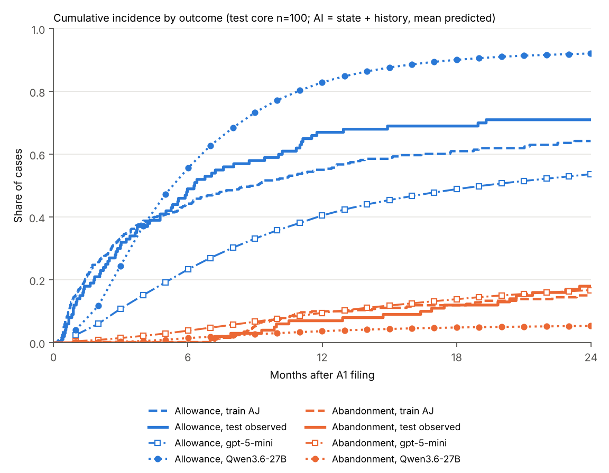
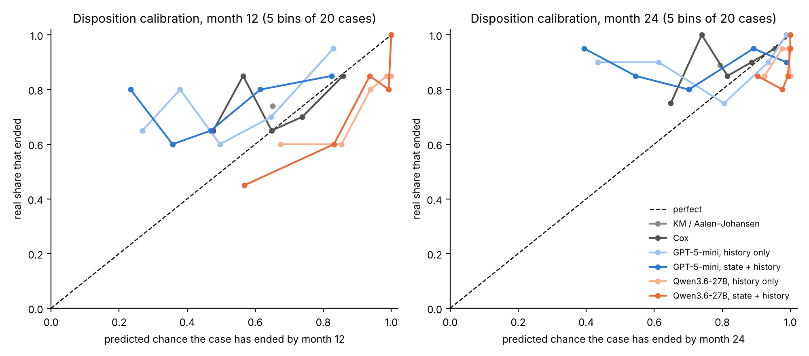
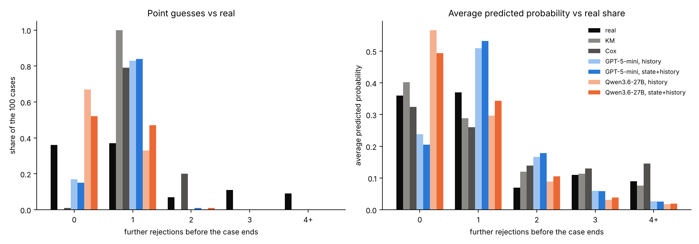
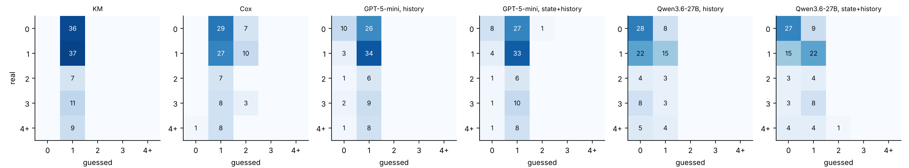
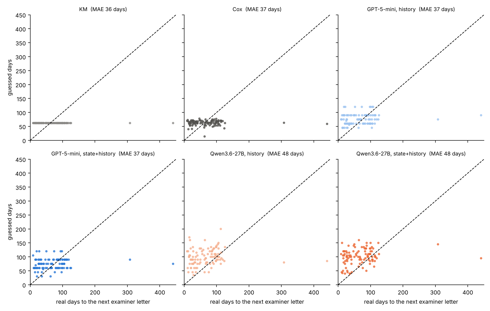

# D Trajectory Forecasting: Week Report (Oct 22)

Oct 22, 2026 · Nancy Hu (D)

_Exported from the claude.ai doc "D Trajectory Forecasting: Week Report (Oct 22)"; pictures are in `results/`._

**All three Trajectory Forecasting rows are now done:** Disposition, Remaining Rounds and Time to Next Action, each with KM, Cox and four AI runs on the same 100 cases, 0 failures. The AI runs are better than the baselines at one thing: telling "this reply will be accepted soon" apart from "more rounds are coming". Evidence: Qwen-with-state allowance AUROC 0.74, AUROC 0.64–0.74 for "no more rejections" in all four runs, and Next Action C-index 0.56–0.58. But no AI run is clearly closer than the plain average on any "how close" score (IBS, Rounds MAE, days). GPT is too slow, Qwen is too optimistic about allowance and about a month too slow on the next letter, and nobody predicts the long, RCE-driven cases.

**Part 1: Report**

## 1. My task: the three purple rows

All three tasks start at the same moment: the day the applicant files the first reply (A1). The model sees only what was filed up to that day and forecasts what happens next.

| Task (paper table) | The question in plain words | Answer type | Metrics |
| --- | --- | --- | --- |
| **Disposition** | When does the case end, and how: allowed or abandoned? | time + how it ended, (T, δ) | C-idx, IBS, Brier@12, Brier@24 |
| **Remaining Rounds** | How many more rejections before the case ends? | a count, N = 0, 1, 2 … | MAE, Accuracy |
| **Time to Next Action** | How many days until the examiner's next letter? | days | C-index, MAE (days) |

- Disposition also gives the main Table 3 columns **C-idx** and **IBS**.
- Every task has the same two baselines (**Marginal / KM** and **Cox**) and the same four AI runs: **GPT-5-mini** and **Qwen3.6-27B**, each with **history only** and with **A's predicted state + history**.
- All runs use the same 100 test cases (`test_core`) and the same 478 training cases.

## 2. What I did

**Last week (Disposition)**

1. **Built the answer key** for the 100 test cases from USPTO transaction records: days from A1 to the first mailed allowance or abandonment notice. It matches A's labels **100/100** (training: 478/478).
2. **Built the training curves** from 478 older cases (A1 dates 2008–2013). Cases still pending on 2013-12-31 count as censored.
3. **Ran the two baselines** (KM / Aalen–Johansen, Cox) and the **four AI runs**.
4. **Scored everything:** C-idx, IBS, Brier at 12 and 24 months, 95% bootstrap intervals, paired comparisons.

**This week**

5. **Built two new answer keys** from the same transaction records:
   - Remaining Rounds = mailed rejections between A1 and the end of the case. Matches A's `remaining_oas` **100/100** on the test cases.
   - Time to Next Action = days from A1 to the next examiner letter. Matches A's next-action date **100/100** (and 1000/1000 over all examples).
6. **Ran KM and Cox** for both new tasks. Rounds are treated as a survival problem, so the 164 training cases that were still open can be used too.
7. **Ran the four AI runs again** with a new prompt that answers both new questions in one call. All 400 calls ended valid (100/100 per run).
   - Qwen ran on a new Azure account (same model, same template, 1 × H100). GPT ran on another new account (same `gpt-5-mini-2025-08-07`).
   - 15 GPT cases hit a rate limit the first time and were re-run one at a time. The finished cases were kept, not paid twice.
8. **Scored both new tasks:** MAE, Accuracy, C-index, MAE in days, 95% intervals, paired comparisons, and graphs.
9. **Finished last week's open Disposition checks:** how the case ends (allowance vs abandonment), calibration and log loss, and the month-6 / month-12 ranking check.
10. **Filled the paper's forecasting table** for all three tasks (`results/forecasting_table.tex`).

Cost this week: GPT about $2 (both settings); Qwen about 2–3 GPU-hours at $7.91/hour (deployment time included).

## 3. Disposition: results (test\_core, 100 cases, 0 failures)

Qwen with state ranks best (C-idx 0.589, interval above 0.5). Qwen history-only has the best probabilities (IBS 0.182), level with the plain average curve. These numbers are the same as last week; I re-scored all six runs this week and every value matched.

| Method | Input | C-idx ↑ \[95% CI\] | IBS ↓ \[95% CI\] | Brier 12m ↓ | Brier 24m ↓ |
| --- | --- | --- | --- | --- | --- |
| Kaplan–Meier / Aalen–Johansen | no case facts | 0.500 (by design) | 0.188 \[0.173, 0.206\] | 0.200 | 0.107 |
| Cox model | 20 case facts | 0.539 \[0.470, 0.602\] | 0.192 \[0.172, 0.214\] | 0.207 | 0.111 |
| GPT-5-mini | history only | 0.549 \[0.477, 0.613\] | 0.223 \[0.196, 0.249\] | 0.241 | 0.150 |
| GPT-5-mini | state + history | 0.493 \[0.427, 0.567\] | 0.248 \[0.217, 0.280\] | 0.280 | 0.181 |
| Qwen3.6-27B | history only | 0.533 \[0.456, 0.601\] | **0.182** \[0.146, 0.224\] | 0.202 | **0.104** |
| Qwen3.6-27B | state + history | **0.589** \[0.532, 0.644\] | 0.187 \[0.153, 0.223\] | **0.184** | 0.108 |

**Paired tests** (same 100 cases; difference with 95% interval; C-idx higher is better, IBS lower is better):

| Comparison | C-idx difference | IBS difference | Clear? |
| --- | --- | --- | --- |
| Qwen − GPT, state + history | +0.095 \[+0.012, +0.172\] | −0.062 \[−0.102, −0.014\] | Yes, Qwen better on both |
| Qwen − GPT, history only | −0.016 \[−0.120, +0.084\] | −0.041 \[−0.084, +0.008\] | No |
| GPT: state − history | −0.055 \[−0.131, +0.032\] | +0.025 \[−0.008, +0.055\] | No |
| Qwen: state − history | +0.056 \[−0.035, +0.153\] | +0.005 \[−0.015, +0.025\] | No |

**The curves.** Left: share still pending. Middle: share allowed. Right: share abandoned. Black = what really happened in the 100 test cases. Grey dashed = the training curve (the KM baseline every case gets). Coloured = each AI run's average prediction. On the left, a line above black = the model thinks cases end later than they do; below = sooner.



The same story as one graph, for the two main runs (state + history). Blue = allowance, orange = abandonment; dashed = training, solid = real test, squares = GPT, circles = Qwen.



**Timing in numbers** (share of cases finished):

|  | By 12 months | By 24 months | Allowed by 24m | Abandoned by 24m |
| --- | --- | --- | --- | --- |
| Real (test) | 0.74 | 0.89 | 0.71 | 0.18 |
| GPT history / state | 0.52 / 0.50 | 0.76 / 0.70 | 0.62 / 0.54 | 0.13 / 0.17 |
| Qwen history / state | 0.89 / 0.87 | 0.98 / 0.97 | 0.93 / 0.92 | 0.05 / 0.05 |

- **GPT thinks cases end too late:** half done by 12 months, really 74%.
- **Qwen thinks they end too early and too well:** 87–89% done by 12 months; 92% allowed and 5% abandoned, really 71% and 18%.

## 4. Disposition, new this week: how it ends, calibration, ranking check

Qwen with state is the only run that clearly tells **which** cases will be allowed (AUROC 0.74, interval above 0.5), but nobody's probabilities are well calibrated: GPT is too low and Qwen too high.

**4a. How it ends (the δ part).** For each ending separately: does the model give a higher chance to the cases that really ended that way? AUROC 0.5 = no better than chance, 1.0 = perfect. Brier = average squared gap (lower is better). Cox gives only "ended or not", so it has no row here; KM gives every case the same chance, so its AUROC is 0.5 by design.

| Method | Allowed by 24m: predicted / real | Brier | AUROC \[95% CI\] | Abandoned by 24m: predicted / real | Brier | AUROC \[95% CI\] |
| --- | --- | --- | --- | --- | --- | --- |
| KM / Aalen–Johansen | 0.64 / 0.71 | **0.210** | 0.50 | 0.15 / 0.18 | 0.148 | 0.50 |
| GPT-5-mini, history only | 0.62 / 0.71 | 0.238 | 0.59 \[0.47, 0.69\] | 0.13 / 0.18 | **0.141** | 0.71 \[0.57, 0.83\] |
| GPT-5-mini, state + history | 0.54 / 0.71 | 0.275 | 0.56 \[0.45, 0.68\] | 0.17 / 0.18 | 0.161 | 0.48 \[0.34, 0.60\] |
| Qwen3.6-27B, history only | 0.93 / 0.71 | 0.248 | 0.60 \[0.46, 0.72\] | 0.05 / 0.18 | 0.163 | 0.59 \[0.44, 0.72\] |
| Qwen3.6-27B, state + history | 0.92 / 0.71 | 0.231 | **0.74 \[0.64, 0.84\]** | 0.05 / 0.18 | 0.160 | 0.65 \[0.51, 0.78\] |

- **Allowance:** Qwen with state sorts the allowed cases from the rest clearly better than chance. Its level is wrong (92% predicted vs 71%), but its order is right.
- **Abandonment:** GPT history-only ranks abandonments best (0.71, interval above 0.5). Qwen with state is also above chance at 12 months (0.71 \[0.54, 0.86\]); at 24 months its interval touches 0.5.
- **Levels:** no AI run beats the plain average curve on Brier for allowance, because every AI level is off by 7–22 points.

**4b. Calibration and log loss** for "has the case ended (either way) by month 12 / 24?". Each run's 100 cases are split into 5 bins of 20 by predicted chance. A well-calibrated run sits on the dashed line: of the cases it gives 80%, about 80% really ended.



| Method | Month 12: predicted / real | Log loss 12m ↓ \[95% CI\] | ECE 12m ↓ | Month 24: predicted / real | Log loss 24m ↓ \[95% CI\] | ECE 24m ↓ |
| --- | --- | --- | --- | --- | --- | --- |
| KM / Aalen–Johansen | 0.65 / 0.74 | **0.59** \[0.54, 0.65\] | **0.09** | 0.79 / 0.89 | 0.38 \[0.31, 0.47\] | 0.10 |
| Cox | 0.66 / 0.74 | 0.60 \[0.53, 0.68\] | 0.10 | 0.81 / 0.89 | **0.38** \[0.29, 0.49\] | **0.08** |
| GPT-5-mini, history only | 0.52 / 0.74 | 0.67 \[0.59, 0.75\] | 0.22 | 0.76 / 0.89 | 0.44 \[0.35, 0.54\] | 0.17 |
| GPT-5-mini, state + history | 0.50 / 0.74 | 0.76 \[0.67, 0.86\] | 0.24 | 0.70 / 0.89 | 0.64 \[0.43, 0.99\] | 0.22 |
| Qwen3.6-27B, history only | 0.89 / 0.74 | 0.98 \[0.54, 1.53\] | 0.15 | 0.98 / 0.89 | 1.09 \[0.46, 1.88\] | 0.09 |
| Qwen3.6-27B, state + history | 0.87 / 0.74 | 0.78 \[0.43, 1.22\] | 0.13 | 0.98 / 0.89 | 0.53 \[0.26, 0.93\] | 0.09 |

- **GPT** sits above the line on the left graph: it says 25–60% for groups where 60–85% really ended. Too slow, as in section 3.
- **Qwen** sits below the line: it says 85–100% where 45–85% ended. Too fast.
- **Qwen's log loss is the worst** even though its Brier is good. Log loss punishes a confident miss very hard: Qwen gives some slow cases 99% "ended by 12 months", and each such miss costs about 4.6 points.
- **The plain average curve and Cox are the best calibrated.** They are not shifted, they just cannot tell cases apart.

**4c. Ranking check (stated last week as a sensitivity, not the frozen metric).** The C-index uses "chance of ending by month 24" as the risk score. Using month 6 or 12 instead:

| Method | Risk = month 6 \[95% CI\] | Month 12 \[95% CI\] | Month 24 (Table 3 score) |
| --- | --- | --- | --- |
| Cox | 0.54 \[0.47, 0.60\] | 0.54 \[0.47, 0.60\] | 0.54 |
| GPT-5-mini, history only | 0.60 \[0.54, 0.67\] | 0.59 \[0.52, 0.66\] | 0.55 |
| GPT-5-mini, state + history | 0.51 \[0.44, 0.59\] | 0.52 \[0.44, 0.59\] | 0.49 |
| Qwen3.6-27B, history only | **0.67** \[0.61, 0.73\] | **0.64** \[0.58, 0.70\] | 0.54 |
| Qwen3.6-27B, state + history | 0.65 \[0.58, 0.71\] | 0.63 \[0.56, 0.69\] | 0.58 |

Three of the four AI runs (all but GPT with state) rank clearly better than chance when asked about the first 6–12 months. Qwen's month-24 score is squeezed because it gives almost every case 97–100% by month 24 (section 14). Cox is the same at every month: it moves every case's curve by one factor, so the order never changes. (These are plain-count C values; the Table 3 column uses the IPCW version, which differs by at most 0.01.)

## 5. Remaining Rounds: results (test\_core, 100 cases, 0 failures)

**No method clearly beats the plain guess "1 more rejection for everyone" on MAE. The AI runs get more cases exactly right (41–49% vs 37%), but they never guess 2 or more, so they miss badly on the long cases.**

The question: after the first reply, how many more rejections (non-final or final) does the examiner mail before the case is allowed or abandoned? Real answers in the 100 test cases: 0 → 36 cases, 1 → 37, 2 → 7, 3 → 11, 4 or more → 9 (mean 1.27).

| Method | Input | MAE ↓ \[95% CI\] | Accuracy ↑ \[95% CI\] | Within ±1 | RPS ↓ | Average guess |
| --- | --- | --- | --- | --- | --- | --- |
| Kaplan–Meier (marginal) | no case facts | 0.99 \[0.77, 1.22\] | 0.37 \[0.27, 0.46\] | 0.80 | 0.168 | 1.00 |
| Cox model | 20 case facts | 1.14 \[0.93, 1.37\] | 0.27 \[0.18, 0.36\] | 0.76 | 0.180 | 1.19 |
| GPT-5-mini | history only | 0.96 \[0.72, 1.22\] | 0.44 \[0.34, 0.53\] | 0.79 | 0.169 | 0.83 |
| GPT-5-mini | state + history | 0.99 \[0.76, 1.24\] | 0.41 \[0.32, 0.51\] | 0.78 | 0.176 | 0.86 |
| Qwen3.6-27B | history only | 1.10 \[0.84, 1.37\] | 0.43 \[0.34, 0.52\] | 0.76 | 0.196 | 0.33 |
| Qwen3.6-27B | state + history | 0.96 \[0.71, 1.23\] | 0.49 \[0.39, 0.59\] | 0.77 | 0.169 | 0.49 |

MAE and Accuracy are the two numbers the paper table asks for. "Within ±1" and RPS (ranked probability score, which scores the whole 0/1/2/3/4+ probability list, section 17) are extra checks.

**Paired tests** (same 100 cases, 1000 bootstrap draws; for MAE a negative difference means the first method is better):

| Comparison | MAE difference | Accuracy difference | Clear? |
| --- | --- | --- | --- |
| Qwen − GPT, state + history | −0.03 \[−0.15, +0.09\] | +0.08 \[−0.03, +0.18\] | No |
| Qwen − GPT, history only | +0.14 \[+0.01, +0.27\] | −0.01 \[−0.13, +0.10\] | Yes: Qwen worse on MAE |
| GPT: state − history | +0.03 \[−0.03, +0.09\] | −0.03 \[−0.08, +0.03\] | No |
| Qwen: state − history | −0.14 \[−0.23, −0.05\] | +0.06 \[−0.01, +0.13\] | Yes: the state helps Qwen |
| GPT history − KM | −0.03 \[−0.10, +0.05\] | +0.07 \[0.00, +0.13\] | No (accuracy right at the edge) |
| GPT state − KM | 0.00 \[−0.08, +0.08\] | +0.04 \[−0.03, +0.11\] | No |
| Qwen history − KM | +0.11 \[−0.04, +0.28\] | +0.06 \[−0.08, +0.19\] | No |
| Qwen state − KM | −0.03 \[−0.17, +0.11\] | +0.12 \[−0.01, +0.24\] | No |
| Cox − KM | +0.15 \[+0.07, +0.23\] | −0.10 \[−0.16, −0.05\] | Yes: Cox worse on both |

**What the guesses look like.** Left: share of cases given each point guess, next to the real share (black). Right: the average probability each method puts on each count.



- KM guesses 1 for every case. The 0.37 accuracy is just the 37 cases that really had 1.
- GPT guesses 1 for most cases (83–84 of 100) and 0 for the rest.
- Qwen leans to 0: 67 of 100 (history only) and 52 of 100 (with state). It expects allowance soon, which is the same "too optimistic" pattern as in Disposition (section 3).
- **Nobody guesses 3 or more, and only Cox guesses 2 for more than one case.** 27 cases really had 2 or more.
- The probabilities tell the same story: the AI runs put 3–6% on "3" and 2–3% on "4+", when the real shares are 11% and 9%. KM and Cox, which learn from the training counts, put about the right weight there.

**Where each method goes wrong** (rows = real count, columns = guess; the darker the cell, the more cases):



The whole bottom of every map (real 2, 3, 4+) sits in the "guessed 0" or "guessed 1" columns. Those cases add 1–6 to the error each, and they decide the MAE.

**Split by how the case went** (average real count, then each method's MAE):

| Group | Cases | Real average | KM | Cox | GPT hist. | GPT state | Qwen hist. | Qwen state |
| --- | --- | --- | --- | --- | --- | --- | --- | --- |
| Ended in allowance | 76 | 0.92 | 0.87 | 1.01 | 0.80 | 0.84 | 0.84 | 0.76 |
| Ended in abandonment | 24 | 2.38 | 1.38 | 1.54 | 1.46 | 1.46 | 1.92 | 1.58 |
| No RCE | 65 | 0.48 | 0.58 | 0.82 | 0.48 | 0.54 | 0.40 | 0.34 |
| 1 or more RCEs | 35 | 2.74 | 1.74 | 1.74 | 1.86 | 1.83 | 2.40 | 2.11 |

- On the simple cases (no RCE, 65 cases) the AI runs are better than KM: Qwen with state is off by 0.34 on average, KM by 0.58.
- The cases with an RCE (35 cases, average 2.7 more rejections) are where everyone fails. An RCE restarts examination, so these cases pile up rejections. At the cutoff nobody can see the RCE coming, and the AI runs guess about 1 or less.
- Abandoned cases also had many rejections (2.4 on average): the applicant usually gives up after several rounds.

**One case read end to end (13826133).** Real: final rejection 20 days after the reply, then an RCE, then a non-final and another final rejection, then allowance. N = 3.

| Method | Guess | Probabilities for 0 / 1 / 2 / 3 / 4+ |
| --- | --- | --- |
| KM | 1 | 0.40 / 0.29 / 0.12 / 0.11 / 0.08 (same for every case) |
| Cox | 1 | 0.31 / 0.26 / 0.14 / 0.14 / 0.15 |
| GPT history / state | 1 / 1 | 0.10 / 0.50 / 0.25 / 0.10 / 0.05 and 0.05 / 0.65 / 0.20 / 0.06 / 0.04 |
| Qwen history / state | 0 / 0 | 0.80 / 0.15 / 0.03 / 0.01 / 0.01 and 0.55 / 0.30 / 0.10 / 0.04 / 0.01 |

Qwen's reason: the amendment "directly overcomes the primary prior art reference", so it expects allowance next. The examiner disagreed three times. GPT expected one more rejection. Everyone is off by 2 or 3 here.

Tables: `results/rounds_next_paired.csv`, `results/rounds_confusion.csv`, `results/rounds_by_group.csv`, `results/rounds_next_examples.csv`. Graphs: `results/rounds_distribution.png/.pdf`, `results/rounds_confusion.png/.pdf`.

## 6. Time to Next Action: results (test\_core, 100 cases, 0 failures)

**The AI runs put the cases in a somewhat better order than chance (C-index 0.56–0.58), but none of them is closer in days than "62 days for everyone". Qwen is about 11 days worse because it guesses 100 days when the real middle is 65.**

The question: how many days after the first reply until the examiner mails the next letter (rejection, advisory action, restriction, Quayle action, allowance or abandonment notice)? Real answers: median 65 days, mean 69, range 9 to 441. The next letter was a final rejection in 60 cases, an allowance in 36, something else in 4.

| Method | Input | C-index ↑ \[95% CI\] | MAE in days ↓ \[95% CI\] | Middle guess (median) | Typical miss (median abs. error) |
| --- | --- | --- | --- | --- | --- |
| Kaplan–Meier (marginal) | no case facts | 0.50 (by design) | 36.3 \[29.3, 45.9\] | 62 | 34 |
| Cox model | 20 case facts | 0.52 \[0.45, 0.58\] | 37.1 \[30.0, 46.6\] | 63 | 31 |
| GPT-5-mini | history only | 0.56 \[0.496, 0.63\] | 37.1 \[29.5, 46.6\] | 75 | 29 |
| GPT-5-mini | state + history | 0.56 \[0.498, 0.62\] | 37.3 \[29.7, 47.2\] | 75 | 30 |
| Qwen3.6-27B | history only | 0.58 \[0.51, 0.65\] | 48.0 \[39.2, 58.2\] | 100 | 38 |
| Qwen3.6-27B | state + history | 0.56 \[0.49, 0.63\] | 48.4 \[40.1, 58.0\] | 100 | 37 |

C-index and MAE in days are the two numbers the paper table asks for. For the AI runs the ranking score is simply "fewer predicted days = sooner"; for Cox it is the Cox risk score (section 15).

**Paired tests** (same 100 cases; C-index higher is better, MAE lower is better):

| Comparison | C-index difference | MAE difference (days) | Clear? |
| --- | --- | --- | --- |
| Qwen − GPT, state + history | +0.003 \[−0.073, +0.081\] | +11.0 \[+5.1, +17.1\] | Yes: Qwen worse on days |
| Qwen − GPT, history only | +0.015 \[−0.075, +0.097\] | +10.9 \[+6.0, +16.4\] | Yes: Qwen worse on days |
| GPT: state − history | −0.003 \[−0.073, +0.077\] | +0.2 \[−3.9, +3.6\] | No |
| Qwen: state − history | −0.014 \[−0.084, +0.066\] | +0.4 \[−4.9, +5.3\] | No |
| GPT history − KM | +0.063 \[−0.003, +0.126\] | +0.8 \[−3.0, +5.1\] | No (C just misses) |
| GPT state − KM | +0.060 \[−0.004, +0.124\] | +1.1 \[−2.9, +4.6\] | No (C just misses) |
| Qwen history − KM | +0.078 \[+0.004, +0.143\] | +11.7 \[+5.1, +19.1\] | Yes: better order, worse days |
| Qwen state − KM | +0.063 \[−0.002, +0.130\] | +12.1 \[+5.1, +19.2\] | Yes: worse days |
| Cox − KM | +0.019 \[−0.055, +0.088\] | +0.8 \[−0.9, +2.7\] | No |

KM gives every case the same guess, so "X − KM" on the C-index is the same as asking "is X better than chance?". Only Qwen history-only clears that bar, and only just. The other three AI runs miss it by less than 0.005.

**Guess vs real, one dot per case** (dashed line = perfect):



- KM and Cox are flat lines around 60 days: they do not move with the case.
- GPT uses a few round numbers (90 days for 32 cases, 60 for 30, 75 for 20) but its dots do drift up with the real days.
- Qwen's dots sit above the line for most cases: it expects the examiner to be slower than they are.
- Two cases took 308 and 441 days (far right). Everyone misses them by 200–380 days, which adds about 6 days to every method's MAE.

**Split by what the next letter was** (real median days, then each method's middle guess):

| Next letter | Cases | Real median | KM | Cox | GPT hist. | GPT state | Qwen hist. | Qwen state |
| --- | --- | --- | --- | --- | --- | --- | --- | --- |
| Final rejection | 60 | 81 | 62 | 67 | 83 | 75 | 100 | 110 |
| Allowance | 36 | 46 | 62 | 62 | 60 | 75 | 85 | 95 |
| Other | 4 | 47 | 62 | 61 | 68 | 75 | 88 | 100 |

- Allowances come much sooner than final rejections (46 vs 81 days). A rejection takes the examiner longer to write.
- GPT history-only gets this direction right (60 vs 83 days, close to the real 46 vs 81 on the rejection side). With the state added, GPT gives 75 for both, so the gap disappears.
- Qwen also gets the direction right (85–95 vs 100–110), but the whole set is shifted up by 20–50 days.
- So the AI's ranking skill mostly comes from one thing: telling "likely allowance soon" apart from "likely another rejection". That is the same judgment as in Remaining Rounds.

**Two cases read end to end:**

| Case | Real | KM | Cox | GPT hist. / state | Qwen hist. / state |
| --- | --- | --- | --- | --- | --- |
| 14622198 (allowed; the applicant took the examiner's suggested claim wording) | allowance after 15 days | 62 | 60 | 45 / 60 | 100 / 50 |
| 13752885 (allowed; the reply fixed the examiner's 112 objections) | allowance after 11 days | 62 | 73 | 75 / 60 | 60 / 45 |

In both cases three of the four AI runs read the reply right: they put rounds = 0, meaning allowance comes next. (GPT with state is the exception: it expects one more rejection.) But even the runs that are right about what comes next guess 45–100 days. They know what comes next but not how fast this examiner is.

Tables: `results/rounds_next_paired.csv`, `results/next_action_by_type.csv`, `results/rounds_next_examples.csv`. Graph: `results/next_action_scatter.png/.pdf`.

## 7. The paper's forecasting table, all three tasks filled

This is the appendix table `tab:forecasting` with every row I am responsible for. It is written by `code/build_forecasting_table.py` to `results/forecasting_table.tex`. The DeepHit, boosted-tree, examiner-profile, agent and proprietary-model rows are not run yet (section 10).

| Approach | Disp. C-index ↑ | Disp. IBS ↓ | Brier@12 ↓ | Brier@24 ↓ | Rounds MAE ↓ | Rounds Acc. ↑ | Next-action C-index ↑ | Next-action MAE (days) ↓ |
| --- | --- | --- | --- | --- | --- | --- | --- | --- |
| Marginal (KM, no covariates) | 0.50 | 0.19 | 0.20 | 0.11 | 0.99 | 0.37 | 0.50 | **36.3** |
| Cox proportional hazards | 0.54 | 0.19 | 0.21 | 0.11 | 1.14 | 0.27 | 0.52 | 37.1 |
| GPT-5-mini, history only | 0.55 | 0.22 | 0.24 | 0.15 | **0.96** | 0.44 | 0.56 | 37.1 |
| GPT-5-mini, state + history | 0.49 | 0.25 | 0.28 | 0.18 | 0.99 | 0.41 | 0.56 | 37.3 |
| Qwen3.6-27B, history only | 0.53 | **0.18** | 0.20 | **0.10** | 1.10 | 0.43 | **0.58** | 48.0 |
| Qwen3.6-27B, state + history | **0.59** | 0.19 | **0.18** | 0.11 | **0.96** | **0.49** | 0.56 | 48.4 |

All values are on the same 100 test cases; every AI run scored 100/100. Intervals are in sections 3, 5 and 6.

## 8. How to read the results

### 8a. Every score in plain words

Think of a weather forecaster. There are two kinds of question: **"is the order right?"** and **"is the number right?"**

| Score | Task | The question it answers | Good / bad | Coin-flip or plain-guess level |
| --- | --- | --- | --- | --- |
| C-index | Disposition, Next Action | Take two cases. Does the model say the right one comes first? Share of pairs right. | higher is better, 1.0 = perfect | 0.5 |
| IBS | Disposition | Each month the model gives "chance still pending"; truth is 1 or 0. Average squared gap over months 1–24. | lower is better | always saying 50% = 0.25 |
| Brier@12, @24 | Disposition | The same squared gap, at month 12 or 24 only | lower is better | 0.25 |
| AUROC | Disposition extras, Rounds P(0) | Like the C-index, for a yes/no outcome: does the model give the "yes" cases a higher chance? | higher is better | 0.5 |
| Log loss | Disposition extras | Like Brier, but a confident wrong answer costs much more | lower is better | always 50% = 0.69 |
| ECE | Disposition extras | Of the cases the model gives 80%, did about 80% happen? Average gap over 5 groups. | lower is better, 0 = perfect | — |
| MAE | Rounds | On average, how many rejections off is the guess? | lower is better | KM's "1 for all" = 0.99 |
| Accuracy | Rounds | Share of cases where the guess is exactly right | higher is better | KM's "1 for all" = 0.37 |
| RPS | Rounds (extra) | How close is the whole 0/1/2/3/4+ probability list? Being off by one costs less than being off by three. | lower is better | KM = 0.168 |
| MAE (days) | Next Action | On average, how many days off is the guess? | lower is better | KM's "62 days for all" = 36.3 |

A model can be good at one kind and bad at the other. Qwen on Next Action is the clearest case: the best order (C 0.58) and the worst days (MAE 48), because it gets which case is faster right but guesses about a month too slow for everyone.

### 8b. What the three tasks say together

1. **The AI can read the reply, a little.** The one thing the AI runs do better than the baselines, in every task, is telling "this reply will be accepted soon" apart from "more rounds are coming":
   - Disposition: Qwen state AUROC for allowance 0.74 \[0.64, 0.84\].
   - Rounds: AUROC of P(0 more) 0.64–0.74 for all four AI runs, every interval above 0.5.
   - Next Action: all AI runs guess shorter waits for allowances; C-index 0.56–0.58.
2. **But the AI's numbers are off.** No AI run is clearly better than the plain average (KM) on a "how close" score: IBS, Rounds MAE, or MAE in days. The best ones only tie it (Qwen IBS 0.182 vs 0.188; GPT history Rounds MAE 0.96 vs 0.99). GPT is too slow on Disposition; Qwen is too fast on Disposition, too optimistic on rounds, and too slow on the next letter.
3. **Long cases are the hard part.** 27 of 100 cases had 2 or more further rejections, mostly after an RCE. No AI run guesses 2 or more for more than one case.
4. **The 20 case facts do not help.** Cox is never clearly better than KM, and on Rounds it is clearly worse.
5. **A's state helps only once.** Qwen's Rounds MAE improves with the state (−0.14 \[−0.23, −0.05\]). In every other task and for GPT, state vs no state is not clearly different.
6. **Qwen vs GPT.** Qwen is clearly better on Disposition with state (C-idx +0.095, IBS −0.062), clearly worse on Next Action days (+11 days), and not clearly different on Rounds with state.

### 8c. What "clear" means here

Every claim of "better" or "worse" comes from a paired test on the same 100 cases: the 95% interval of the difference must not include 0. With 100 cases the intervals are wide (about ±0.07 for a C-index, ±0.12 for Rounds MAE, ±5 days for MAE in days), so many differences that look large in the table are "not clear".

## 9. Limits to say out loud

### All three tasks

- **Pilot size.** 100 test cases, so intervals are wide. Claims are "clearly different" or "not clearly different", never a ranking of models in general.
- **Settings differ.** GPT ran with reasoning effort "low"; Qwen with its provider default thinking (team setting). This compares the two setups, not just the models. Qwen also writes about 5 times more output tokens per case.
- **Train and test differ in time.** Training cases are 2008–2013, test cases 2014–2017. Test cases end faster (11% still pending at 24 months vs 21% in training), and their next letter comes a little later (median 65 vs 59 days). This hurts KM and Cox, which learn only from training.
- **Possible memory.** These are public patents and both models were trained later. The prompts say not to use remembered facts, but we cannot prove the models did not. Their reasons quote the record ("the examiner indicated claims would be allowable"), which is a good sign.
- **One run per setting.** Each AI run was done once. A second run with the same prompt could give somewhat different answers, especially for GPT's round-number guesses.

### Disposition

- **Qwen needed more format fixes.** Its curves were repaired in 19–23 cases per run (vs 6–7 for GPT): a curve that dipped was made non-decreasing, or allowed + abandoned above 1 was scaled down. The rules were frozen before scoring, and no case was dropped.
- **Qwen's ranking score is squeezed.** It gives almost every case 97–99% by 24 months, so many pairs tie. Ranking by the month-6 or 12 chance gives 0.63–0.67 (section 4c; a pre-stated check, not the frozen metric).
- **Weighting choice matters for IBS.** With censoring weights from the training years instead of the test labels, KM and Cox beat Qwen on IBS (0.27–0.28 vs 0.30); the C-idx order stays. The test-label weights are the pre-stated main choice.
- **Calibration is poor for every AI run** (section 4b): GPT too low, Qwen too high. Any probability from these runs should not be read at face value.

### Remaining Rounds and Time to Next Action

- **The cutoff is the A1 filing date, not O1.** The task table lists the Remaining Rounds input as H\_t, S\_t (no reply). I used the same cutoff as Disposition and the paper's forecasting prompt, so the reply is in the record. An O1 cutoff would need new inputs and new states. This is a team / mentor decision.
- **RCEs are invisible at the cutoff.** 35 cases later had an RCE, and they average 2.7 more rejections. No model can see that coming from the first reply, so the Rounds MAE has a floor that better prompting alone will not remove.
- **The point guess throws away the probabilities.** The paper table scores the whole-number guess. The AI runs round to 0 or 1, so their useful signal (AUROC 0.64–0.74 on P(0)) does not show in MAE or Accuracy. RPS, which uses the probabilities, is reported as an extra.
- **Two outliers in Next Action.** Two cases took 308 and 441 days; they add about 6 days to every MAE. They are real and stay in.
- **One label difference with A, outside test\_core.** My rounds count equals A's `remaining_oas` for 100/100 test\_core cases and 992/1000 overall. In the other 8, the USPTO catalog lists the same final rejection twice on the same day, and A counts it twice. It does not affect any score here, but A's field may need a fix.
- **GPT re-run for rate limits.** 15 GPT cases first failed with Azure 429 errors (no answer at all) and were re-run with one worker. No answer was changed or chosen; the cache kept every answer the first time it arrived.

## 10. Next steps

### Do now (about 15 minutes, no cost)

- [ ] **Stop the Qwen bill if the endpoint is still up.** A Managed Compute H100 deployment is charged every hour it exists, even when nobody calls it. All runs are finished, so it can go.
  1. Open ai.azure.com and sign in with the account that has the Qwen deployment (the new personal one).
  2. Open the project, then **Models + endpoints** in the left menu.
  3. Tick `qwen--qwen36-27b` and click **Delete**. Confirm.
  4. Check: the list no longer shows it. In portal.azure.com, **Cost Management → Cost analysis** should stop growing from the next day.
  5. The GPT-5-mini deployment on the other account is pay-per-token, so it costs nothing while idle. You can leave it.
- [ ] **Push last week's folder first.** On the Mac open `1006 Capstone/repo_upload/2026-10-15_qwen_outputs_plot/`.
  1. On GitHub open the repo's main page → **Add file → Upload files**.
  2. Drag the `d_trajectory` folder that is **inside** `2026-10-15_qwen_outputs_plot` (not the dated folder itself) into the upload box.
  3. Commit message: `D: Qwen predictions, run log, paired tests, plots (2026-10-15)`. Choose **Commit directly to the main branch** → **Commit changes**.
- [ ] **Then push this week's folder** the same way: `1006 Capstone/repo_upload/2026-10-22_three_tasks/d_trajectory`. Commit message: `D: Remaining Rounds + Time to Next Action (KM, Cox, GPT, Qwen), Disposition extras, forecasting table`. Skip `2026-10-21_rounds_next`: everything in it is in the 10-22 folder, newer.
  - Check after: on GitHub, `d_trajectory/results/forecasting_table.tex` should show six rows with numbers in every column.
- [ ] **Paste the table into the paper.** Copy the rows of `results/forecasting_table.tex` into the `tab:forecasting` table in Overleaf (the column order matches the draft).

### Questions to raise at the team meeting (decisions, not work)

- [ ] **Remaining Rounds cutoff:** keep A1 (same as Disposition and the paper's forecasting prompt), or switch to O1 as the task table's "H\_t, S\_t" suggests? Switching means new inputs, new states from A and new AI runs.
- [ ] **Tell A** about the 8 double-counted final rejections in `remaining_oas` (list in `rounds_next_label_audit.csv`; none in test\_core). Ask whether A wants to fix the field.
- [ ] **Which further rows of `tab:forecasting` to fill**, since each costs time or money: DeepHit and boosted trees (only 478 training cases; boosted trees first), "state + examiner profile" (needs B's profiles), "agent" (needs the team's agent design), proprietary frontier models (API cost).

### If there is time (my own tasks, optional)

- [ ] **A calibration fix:** give the model the training base rates in the prompt ("74% of cases end within a year; the next letter usually comes after about 2 months; 27% of cases have 2 or more further rejections") and re-run one setting. This targets the biggest weakness in all three tasks.
- [ ] **Scale to the 300 test cases:** the answer keys exist (`gold/*_test300.csv`). KM and Cox are free; AI runs cost about 3 times this week's.

## 11. Q&A

### All three tasks

| Question | Short answer |
| --- | --- |
| Is 100 cases enough? | For a pilot, yes. Intervals are wide, so I only claim differences whose paired interval excludes 0. |
| Is Qwen vs GPT fair? | Same cases, documents, prompts, state, scoring and repair rules. Different thinking settings (team decision), so it compares setups. |
| Why is KM's C-index exactly 0.5? | It gives every case the same answer, so every pair is a tie, and a tie counts as half right. It is there as the "how close" baseline. |
| Why does a plain average beat the AI on the "how close" scores? | The AI's levels are shifted (GPT too slow, Qwen too optimistic or too slow). The average is not shifted, it just cannot tell cases apart. |
| Could the model remember the outcome? | Possible: public patents, later training data. The prompts forbid it; we cannot rule it out. The reasons quote the record, which is a good sign. |
| Did A's state help? | Clearly only once: Qwen on Rounds (MAE −0.14). Everywhere else state vs no state is not clearly different. |
| What is the most useful next experiment? | Give the model base rates in the prompt and re-run one setting (calibration is the biggest weakness everywhere). |

### Disposition

| Question | Short answer |
| --- | --- |
| Why monthly curves, when the draft prompt asks for one 24-month probability? | IBS and Brier@12 need a probability at every month. The curve contains the draft's numbers: allowed, abandoned and "neither" at month 24. |
| How do you know the labels are right? | Rebuilt independently from USPTO transactions, 100/100 match A's labels, with documented traps (ABN9, revival, notice date vs legal date). |
| What about censoring? | Test cases all ended. In training, 164 of 478 cases were still pending on 2013-12-31; they count as "still waiting" up to that date, never as "never ends". |
| Why is Qwen's log loss so bad when its Brier is good? | Log loss punishes confident misses without limit; Qwen says 99% for some slow cases. Brier caps the cost of one miss at 1. |

### Remaining Rounds and Time to Next Action

| Question | Short answer |
| --- | --- |
| What counts as a "round"? | A mailed non-final or final rejection after the cutoff and up to the first allowance or abandonment notice. Rejections after an RCE count; advisory actions, restrictions, Quayle actions and interview summaries do not. |
| How do you know the labels are right? | My rounds count matches A's `remaining_oas` for 100/100 test cases, and my next-letter date matches A's `target` for 1000/1000 examples. |
| Why treat a count like a survival time? | 164 training cases were still open, so we only know "at least k rejections". Ignoring them makes 0 look far too common (57% vs 40%). Survival methods use "at least k" properly. |
| Why do the baselines guess the median? | The median gives the smallest average absolute error, which is what MAE measures (section 17c). |
| Why are the AI runs more accurate but not lower in MAE? | They get more cases exactly right (mostly 0s), but they never guess 2+, so the 27 long cases cost them 1–6 each. |
| Does scoring the median of the AI's probabilities change anything? | No. That version is already in `rounds_next_metrics.json` (`mae_dist_median`): GPT 0.97 / 0.97, Qwen 1.07 / 0.95, the same picture. |
| Why is Qwen the best at ranking next letters but the worst in days? | C-index looks only at order; Qwen orders well but guesses about 100 days for a median of 65. A fixed shift of one month costs MAE, not C-index. |
| Why does nobody predict long waits or many rounds? | The long cases are mostly the ones that later need an RCE or are abandoned after several rounds. The first reply shows almost nothing about that. |
| Why one prompt for two tasks? | Both ask about the same moment and the same documents; one call halves the cost and keeps the answers consistent (rounds = 0 and a short wait go together). |
| How big were this week's runs? | Four AI runs of 100 cases each, about 17 million input tokens in total (8.2 million GPT, 8.9 million Qwen); all 400 answers valid on the first try. |

**Part 2: How it works, with real examples**

## 12. The data: train, test, and what "y" is

One row = one patent application, frozen on the day of its first reply (A1). As in any table there are inputs (X) and a target (y). The three tasks use the same rows and the same X; only y changes.

| Task | y for one case | Example (13826133) | Answer file |
| --- | --- | --- | --- |
| Disposition | **time\_days** until the case ends + **event** (allowance, abandonment, or censored) | 394 days, allowance | `gold/trajectory_gold.csv` |
| Remaining Rounds | **rounds** = rejections still to come (+ censored flag) | 3 | `gold/rounds_next_gold.csv` |
| Time to Next Action | **next\_days** until the examiner's next letter (+ censored flag) | 20 days (a final rejection) | `gold/rounds_next_gold.csv` |

- **Censored** = the case was still open when we stopped watching. We then know only "at least this long" (or "at least this many rejections").
- From y for many cases you can draw a **curve**: at each month, the share still waiting. The baselines use that curve.

| Set | How many | A1 dates | Used for | File |
| --- | --- | --- | --- | --- |
| Train | 478 = 448 train + 30 boundary | 2008-12 to 2013-12 | KM curves and Cox models | `inputs/trajectory_train_labels.csv`, `inputs/rounds_next_train_labels.csv` |
| Test core | 100 (one per patent family) | 2014-01 to 2017-05 | Score every method | the gold files above; AI input = `inputs/trajectory_inputs.jsonl` |
| Test (full) | 300 | 2014 onward | Optional extension (labels built, not scored yet) | `gold/*_test300.csv` |
| Dev | 3 | — | Check the AI answer format only, not scored | `inputs/trajectory_inputs_dev.jsonl` |

- **Why train stops at 2013-12-31:** A's split rule. The training "world" ends there and the test cases start after it, so nothing from the future leaks into training.
- **Why 448 + 30:** the 30 boundary cases had their A1 before 2014 but ended after it. Dropping them would keep only the fast ones, so they stay in as **censored at 2013-12-31**.
- **Why 100 test cases:** `test_core` is A's fixed main subset of the 300 test cases, one per family.

**What the training data look like for each task**

|  | Ended / observed by 2013-12-31 | Censored |
| --- | --- | --- |
| Disposition | 264 allowed, 50 abandoned | 164 |
| Remaining Rounds | 314 (0 rounds: 180, 1: 92, 2: 26, 3: 12, 4+: 4) | 164 (we saw 0–6 rejections so far) |
| Time to Next Action | 448 (median 59 days) | 30 (the boundary cases) |

**The 100 test cases** (nothing censored in any task):

- Disposition: 76 allowed, 24 abandoned; median 191.5 days; 11 took longer than 24 months.
- Remaining Rounds: 0 → 36 cases, 1 → 37, 2 → 7, 3 → 11, 4 → 4, 5 → 4, 7 → 1 (average 1.27). 35 cases had at least one RCE.
- Time to Next Action: the next letter was a final rejection for 60 cases, an allowance for 36, a non-final rejection for 3, a restriction for 1. Median 65 days (range 9–441).

## 13. Building the three answer keys from USPTO records

Every application has a **transaction history**: a dated list of everything the patent office logged (`apps/<id>/transactions.csv` in A's data). All three answer keys are read from it with fixed rules, then checked against A's labels.

| Task | Rule, per case | Check against A |
| --- | --- | --- |
| Disposition | First mailed `MN/=.` (allowance) or `MABN…` (abandonment) after A1; days = that date − A1 date | 100/100 test, 478/478 train |
| Remaining Rounds | Count mailed `MCTNF` (non-final) + `MCTFR` (final rejection) after A1, up to that end date | 100/100 test (992/1000 overall, see below) |
| Time to Next Action | First mailed `MCTNF`, `MCTFR`, `MCTAV` (advisory), `MCTRS` (restriction), `MCTEQ` (Quayle), `MN/=.` or `MABN…` after A1 | 1000/1000 |

Not counted as a round: advisory actions, restriction requirements, Quayle actions, interview summaries, examiner's answers on appeal. Counted: rejections after an RCE, because an RCE does not end the case.

**Example 1: easy case, 13752885**

```csv
event_date,event_code,event_description
2014-12-12,MCTNF,Mail Non-Final Rejection
2015-03-12,A...,Response after Non-Final Action   <- A1 = cutoff
2015-03-20,N/=.,Notice of Allowance Data Verification Completed
2015-03-23,MN/=.,Mail Notice of Allowance   <- END: allowed; also the next letter
2015-07-28,PGM/,Recordation of Patent Grant Mailed
```

Answers: allowed after 2015-03-23 − 2015-03-12 = **11 days**; **0** further rejections; next letter after **11 days**. `N/=.` (an internal check) and the patent grant are not the event; the mailed notice is.

**Example 2: many rounds with an RCE, 13826133**

```csv
event_date,event_code,event_description
2014-03-04,A...,Response after Non-Final Action   <- A1 = cutoff
2014-03-24,MCTFR,Mail Final Rejection   <- next letter (20 days); round 1
2014-05-09,RCEX,Request for Continued Examination (RCE)   <- case continues
2014-06-02,MCTNF,Mail Non-Final Rejection   <- round 2
2014-11-21,MCTFR,Mail Final Rejection   <- round 3
2015-03-04,MCTAV,Mail Advisory Action   <- not a round
2015-04-02,MN/=.,Mail Notice of Allowance   <- END: allowed (394 days)
```

Answers: allowed after **394 days**; **3** further rejections; next letter after **20 days**.

**Example 3: the ABN9 trap, 13816667**

```csv
event_date,event_code,event_description
2014-11-12,A...,Response after Non-Final Action   <- A1 = cutoff
2015-02-25,MCTNF,Mail Non-Final Rejection   <- next letter (105 days); round 1
2015-08-28,MCTFR,Mail Final Rejection   <- round 2
2015-12-28,RCEX,Request for Continued Examination (RCE)
2016-01-13,ABN9,Disposal for a RCE / CPA / R129   <- NOT an ending
2016-03-16,MCTNF,Mail Non-Final Rejection   <- round 3
2016-10-13,MCTFR,Mail Final Rejection   <- round 4
2017-05-17,ABN2,Aband. for Failure to Respond to O. A.
2017-05-23,MABN2,Mail Abandonment for Failure to Respond   <- END: abandoned
```

`ABN9` starts with "ABN" but only means "the RCE was processed"; the case keeps going. A naive rule would stop on 2016-01-13 (427 days). The right answer: abandoned on 2017-05-23, **923 days**, using the mail date (not the legal date 2017-05-17); **4** further rejections; next letter after **105 days**. 35 of the 100 test cases have an ABN9 row in between.

**Example 4: revived case, 13698575.** It was abandoned 604 days after A1 (mailed 2016-10-20), then revived in 2017 and later allowed. Our rule counts the **first** ending, so it stays "abandoned at 604 days", and its rounds stop there too. 3 test cases are like this (13698575, 13060040, 14400543). This rule was written down before scoring (`forecast_protocol.md`).

**Why my rounds count differs from A's in 8 of 1000 cases.** In those cases USPTO's document list shows the same final rejection twice on the same day (e.g. 12016339: one mailed `MCTFR` on 2010-06-16, two `CTFR` documents). A counts documents; I count mailed transactions, so one letter = one round. None of the 8 is in the 100 test cases (7 training, 1 in the 300-case extension). This is a question for A, not a change to our scores.

## 14. Cutoff, horizon, censoring, family resampling

**Cutoff = the A1 filing date; the model sees nothing after it.** For 13752885 the cutoff is 2015-03-12. The model gets the application, O1 and the A1 reply (all dated on or before 2015-03-12), never the allowance notice of 2015-03-23; otherwise it would be reading the answer. `build_trajectory_data.py` refuses any input document dated after the cutoff. The same input files serve all three tasks.

**Horizon and rules fixed before looking at the test answers.** Disposition: months 1 to 24, written in `forecast_protocol.md` before scoring. Rounds and next action: what counts as a round and as a letter, written in `rounds_next_protocol.md` before any AI run. Picking a rule after seeing results lets you pick the one that flatters your model; fixing it first prevents that.

**Censored, not negative.** Training case 12292346 had its A1 on 2012-01-09 and was still pending on 2013-12-31, 722 days later, where the training data stop.

- **Disposition:** wrong = call it "never ends" (curve too slow) or delete it (throws away "lasted at least 722 days", curve too fast). Right = count it as "still pending" for every month up to day 722, then stop counting it. Kaplan–Meier does exactly this.
- **Remaining Rounds:** the same idea for a count. If we saw 2 rejections by 2013-12-31 and the case was still open, all we know is "N is at least 2". Section 15 shows how the baseline uses that.
- **Time to Next Action:** a boundary case whose next letter came after 2013-12-31 counts as "no letter yet after N days".

**Family resampling for intervals.** A patent family = related applications (a parent and its continuations) that share most of their text. The 95% intervals come from the bootstrap: draw 100 cases at random with replacement, re-score, repeat 1,000 times, keep the middle 95%. Two family members in the same test set would move together, and treating them as independent makes intervals too narrow. In test core every case is from a different family (A's rule: one per family), so drawing cases **is** drawing families.

## 15. The baselines (no AI) for all three tasks

Code: `code/baselines_trajectory.py` (Disposition) and `code/baselines_rounds_next.py` (Remaining Rounds, Time to Next Action). Input: the same 478 training rows. Output: `outputs/D/trajectory_predictions_{km,cox}.jsonl` and `outputs/D/rounds_next_predictions_{km,cox}.jsonl`.

The paper table asks for two baselines in every column: **Marginal (no covariates)**, which is Kaplan–Meier, and **Cox proportional hazards**.

### 15a. Kaplan–Meier (KM): the average curve

Go step by step through the training cases. At each step: of the cases still waiting at the start, what share ended? Multiply.

- Toy example, 100 cases: month 1, 5 end → waiting 95/100 = 0.95. Month 2, 10 of the 95 end → 0.95 × 85/95 = 0.85. A censored case counts as "still waiting" while we can see it, then leaves the count.
- Aalen–Johansen does the same but splits "ended" into allowed vs abandoned.
- Every test case gets **the same curve**. That is why KM's C-index is 0.5 in every column: it cannot tell cases apart.

**Disposition (last week).** Share still pending: month 1 = 0.85, month 3 = 0.67, month 6 = 0.56, month 12 = 0.35, month 18 = 0.27, month 24 = 0.21. By month 24: 0.64 allowed, 0.15 abandoned.

**Time to Next Action (new).** Same method, but the clock stops at the first examiner letter. Share of cases still waiting for that letter:

| Day | 30 | 60 | 62 | 90 | 120 | 180 |
| --- | --- | --- | --- | --- | --- | --- |
| Still waiting | 0.73 | 0.52 | **0.50** | 0.25 | 0.09 | 0.02 |

The curve crosses 0.5 at day 62, so KM guesses **62 days for every case**. (Point guess = the middle of the curve, the median: section 17 shows why the median is the right choice for MAE.)

**Remaining Rounds (new): counting rejections as a survival problem.** This is the one new idea this week. Why not just average the training counts? Because 164 of the 478 training cases were still open on 2013-12-31, so for them we only know "at least k rejections so far". The fix: treat the count like a clock.

- "Time" = N + 1. A case that ended with N = 0 more rejections "ends at step 1", N = 1 at step 2, and so on.
- A case still open with k rejections seen is censored at k + 0.5: it survived past step k, but we do not know when it ends.
- Real training case **12813013**: A1 on 2013-06-20, one final rejection on 2013-10-09, still open on 2013-12-31. So it is censored at 1.5 ("at least 1"). In A's full data it later had 3. Counting it as 1 would be wrong; dropping it would be wrong too.

Why this matters: among the 314 training cases that did end, 180 (57%) had 0 more rejections. That is too low, because long cases are the ones still open. KM, using the censored cases properly, gives:

| Further rejections | 0 | 1 | 2 | 3 | 4+ |
| --- | --- | --- | --- | --- | --- |
| P(N ≥ k) from the curve | 1.00 | 0.60 | 0.31 | 0.19 | 0.08 |
| P(N = k) = P(N ≥ k) − P(N ≥ k+1) | **0.40** | **0.29** | **0.12** | **0.11** | **0.08** |

The median is 1 (P(N = 0) = 0.40 is under half; P(N ≤ 1) = 0.69 is over half). So KM guesses **1 for every case**. Its probabilities are close to the real test shares (0.36 / 0.37 / 0.07 / 0.11 / 0.09), which is why its RPS is the best in section 5.

### 15b. Cox model: the average curve, sped up or slowed down per case

The same 20 case facts in all three tasks (tech center, reply strategy, days from filing to O1, days from O1 to A1, number of grounds, and so on). The model learns a weight per fact. A positive weight = the clock runs faster (ends sooner, or fewer rejections). Weights are on standardized facts, with ridge shrinkage α = 1 because there are only 478 training cases.

| Disposition (last week) | Weight |  | Remaining Rounds (new) | Weight |  | Next Action (new) | Weight |
| --- | --- | --- | --- | --- | --- | --- | --- |
| Tech center 2800 | +0.25 |  | Applicant cancelled claims | +0.16 |  | Terminal disclaimer filed | +0.14 |
| Applicant cancelled claims | +0.24 |  | Terminal disclaimer filed | +0.15 |  | Applicant added claims | −0.11 |
| Terminal disclaimer filed | +0.23 |  | Days filing → O1 (log) | −0.10 |  | Applicant cancelled claims | +0.08 |
| Days O1 → A1 (log) | −0.20 |  | Tech center 2800 | +0.08 |  | Applicant argued | −0.07 |
| Days filing → O1 (log) | −0.17 |  | Tech center 3600 | +0.07 |  | Declaration / affidavit | −0.07 |
| Number of grounds in O1 | −0.11 |  | Days O1 → A1 (log) | −0.07 |  | Applicant amended claims | −0.06 |

The same facts come back (cancelled claims and a terminal disclaimer point to a quick, clean end), but every weight is small. For Rounds, 79 of 100 cases still get a median of 1, and 20 get 2.

- **Rounds point guess** = the median of that case's count distribution. **Next action point guess** = the median day of that case's curve. **Next action ranking score** = the Cox risk score itself.
- Cox does worse than KM on Rounds (MAE 1.14 vs 0.99). It moves 20 cases to "2", and most of them really had 0 or 1.

**The example cases:**

| Case | Really | Disposition: pending at month 12 (KM / Cox) | Rounds (KM / Cox) | Next action days (KM / Cox) |
| --- | --- | --- | --- | --- |
| 13752885 | allowed after 11 days, N = 0 | 0.35 / 0.46 | 1 / 1 | 62 / 73 |
| 13816667 | abandoned after 923 days, N = 4 | 0.35 / 0.28 | 1 / 1 | 62 / 59 |
| 13826133 | allowed, N = 3, next letter after 20 days | — | 1 / 1 | 62 / 60 |

Cox puts the fast case and the slow case nearly the same on every task. That is the common thread: the 20 simple case facts do not predict how prosecution goes after the reply.

## 16. The AI step: what goes in, what comes out (both prompts)

There are two prompts. Both get exactly the same input documents for a case; only the question differs.

|  | Prompt 1: Disposition (last week) | Prompt 2: Rounds + Next Action (new) |
| --- | --- | --- |
| Prompt file | `prompts/trajectory_forecast.txt` | `prompts/rounds_next_forecast.txt` |
| Code | `code/run_trajectory_llm.py` | `code/run_rounds_next_llm.py` (reuses the input and API code of the first) |
| Colab | `D_trajectory_run.ipynb` (GPT), `D_trajectory_qwen.ipynb` (Qwen) | `D_rounds_next_run.ipynb` (one copy for GPT, one for Qwen) |
| Calls | 1 per case per run | 1 per case per run, answering both tasks at once |
| Output | `outputs/D/trajectory_predictions_<run>.jsonl` | `outputs/D/rounds_next_predictions_<run>.jsonl` |

Four runs each: GPT-5-mini (reasoning effort low) and Qwen3.6-27B (team setting: Azure H100, provider default thinking, only model + messages + max\_tokens sent), each with history only and with A's A1 state added.

### 16a. What goes in (case 13752885)

The input record lists every document dated on or before the cutoff; the code pastes their full text into the prompt (about 36,600 tokens here):

| doc | code | date | role |
| --- | --- | --- | --- |
| HCJI8SC7PXXIFW3 | SPEC (description) | 2013-01-29 | record |
| HCJI8SDUPXXIFW3 | CLM (original claims) | 2013-01-29 | record |
| I3LNSDYDPXXIFW4 | CTNF (O1, non-final rejection) | 2014-12-12 | O1 |
| I76JEOWDPXXIFW3 / Z4 / ZD | A..., CLM, REM (the reply) | 2015-03-12 | A1 |

In the "state + history" setting, A's predicted state (claims, open rejections) is added as a JSON block. In "history only" it says "not provided". Nothing dated after the cutoff can get in: the input builder refuses it.

### 16b. Prompt 1 (Disposition): what we ask and what comes out

For each month m = 1 to 24: the chance that by the end of month m the first ending is (a) allowance mailed, (b) abandonment mailed. Both lists never go down, and their sum is at most 1. JSON only, plus a 3-sentence rationale.

Qwen, state + history, on 13752885:

| Month | 1 | 2 | 3 | 4 | 6 | 12 | 24 |
| --- | --- | --- | --- | --- | --- | --- | --- |
| Allowed by then | 0.05 | 0.20 | 0.50 | 0.75 | 0.90 | 0.97 | 0.98 |
| Abandoned by then | 0 | 0 | 0 | 0.005 | 0.01 | 0.01 | 0.01 |
| Still pending (1 − both) | 0.95 | 0.80 | 0.50 | 0.25 | 0.09 | 0.02 | 0.01 |

Rationale: "The examiner's initial action explicitly invited amendment, stating claims would be allowable if rewritten in independent form, and the applicant's reply … incorporated those exact limitations." Really: allowed after 11 days. GPT on the same case said 89% still pending at month 12; it missed the "would be allowable" signal.

Repairs (frozen rules): a list that goes down is raised to its running maximum; if allowed + abandoned > 1, both are scaled down; broken JSON gets one retry. Qwen needed 19–23 repaired cases per run, GPT 6–7, 0 unusable.

### 16c. Prompt 2 (Remaining Rounds + Time to Next Action): what we ask

The same documents, then two questions (wording shortened):

- **Task 1:** "How many further Office Actions will the USPTO mail after the cutoff, before the first Notice of Allowance or abandonment notice? Count only non-final and final rejections… Do not count advisory actions, restriction requirements, Quayle actions, interview summaries… An RCE does not end prosecution: rejections after an RCE do count." Answer: a probability for 0 / 1 / 2 / 3 / 4+ (summing to 1) and one whole-number best guess.
- **Task 2:** "How many days after the cutoff will the USPTO mail its next communication of any of these kinds: non-final rejection, final rejection, advisory action, restriction requirement, Quayle action, Notice of Allowance, or abandonment notice?" Answer: one whole number of days.
- **Procedural facts given to the model:** a reply is due in 3 months (6 with fees); no reply leads to abandonment; after a final rejection the applicant usually files an RCE, appeals, replies, or gives up.
- **Rules:** use only the documents, not anything remembered about this patent; show uncertainty through the probabilities.

The counting rules in the prompt are the same rules the answer key uses (section 13), so the model is asked exactly the question it is scored on.

Output format:

```json
{"p_further_actions": {"0": p, "1": p, "2": p, "3": p, "4+": p},
 "further_actions": whole number,
 "days_to_next_action": whole number,
 "rationale": "at most three sentences"}
```

### 16d. Prompt 2: what comes out (case 13752885, state + history)

|  | GPT-5-mini | Qwen3.6-27B | Really |
| --- | --- | --- | --- |
| P(0 / 1 / 2 / 3 / 4+) | 0.20 / 0.60 / 0.15 / 0.04 / 0.01 | 0.85 / 0.10 / 0.03 / 0.01 / 0.01 | N = 0 |
| Best guess, rounds | 1 | 0 | 0 |
| Days to next letter | 60 | 45 | 11 (allowance) |
| Input / output tokens | 41,982 / 406 | 45,293 / 1,861 |  |
| Seconds | 6.9 | 52.3 |  |

GPT: "examiners commonly respond with one further office action … rather than multiple rounds. Typical examiner turnaround from a substantive reply is on the order of 1–3 months."

Qwen: "The examiner previously indicated that the claims would be allowable if rewritten … This typically leads to a Notice of Allowance on the next examiner communication without further rejections."

The same split as in Disposition: Qwen picks up the "would be allowable" signal, GPT falls back on what is typical.

### 16e. Checks on the answer (frozen in `run_rounds_next_llm.py` before scoring)

1. `p_further_actions` must have exactly the keys 0, 1, 2, 3, 4+.
2. Values outside 0–1 are clipped; if they do not sum to 1 they are divided by their sum (all zero = broken answer).
3. `further_actions` and `days_to_next_action` must be numbers ≥ 0 and are rounded to whole numbers; 0 days becomes 1.
4. A broken answer is retried once with the same prompt, then listed as failed. Never filled with a default.

Result: **all four runs 100/100 on the first try, 0 repairs, 0 failures.** This prompt is much simpler to follow than the 24-month curves of Prompt 1.

| Run | Input tokens per case (mean) | Output tokens per case (mean) | Seconds per case (median) |
| --- | --- | --- | --- |
| GPT-5-mini, history / state | 37,216 / 44,809 | 402 / 399 | 14 / 17 |
| Qwen3.6-27B, history / state | 40,726 / 48,755 | 2,160 / 2,204 | 56 / 62 |

Qwen "thinks" about 5 times longer (more output tokens) and takes about 4 times as long. All four runs used the same prompt (hash `2e8f78f097`). On the first GPT attempt, 15 cases hit Azure rate limits (429 errors, no answer at all). They were re-run with 1 worker; the answers already saved in the cache were kept, not asked again.

## 17. Scoring: formulas and worked numbers

Code: `code/score_trajectory.py` (Disposition), `code/analyze_disposition_extra.py` (Disposition extras), `code/score_rounds_next.py` and `code/analyze_rounds_next.py` (the two new tasks). Library: scikit-survival 0.28. Results: `metrics/D/trajectory_metrics.json`, `metrics/D/disposition_extra.json`, `metrics/D/rounds_next_metrics.json`.

| Task | Paper columns | Extra checks in this report |
| --- | --- | --- |
| Disposition | C-idx, IBS, Brier@12, Brier@24 | AUROC and Brier per ending, log loss, calibration (ECE) |
| Remaining Rounds | MAE, Accuracy | Within ±1, RPS, confusion table |
| Time to Next Action | C-index, MAE in days | median error, split by letter type |

### 17a. Disposition (last week)

**Brier score at month t.** For case i, Sᵢ(t) is the predicted chance it is still pending at t; yᵢ(t) is 1 if it really was still pending, else 0.

```latex
\mathrm{Brier}(t) = \frac{1}{n}\sum_{i=1}^{n} \big(S_i(t) - y_i(t)\big)^2
```

Worked at month 12 for the two example cases:

| Case | Really at month 12 | KM says pending | Error KM | GPT state | Error GPT | Qwen state | Error Qwen |
| --- | --- | --- | --- | --- | --- | --- | --- |
| 13752885 | ended (y = 0) | 0.35 | (0.35 − 0)² = 0.12 | 0.89 | 0.79 | 0.02 | 0.00 |
| 13816667 | pending (y = 1) | 0.35 | (0.35 − 1)² = 0.42 | 0.71 | 0.08 | 0.14 | 0.74 |
| Average of the two |  |  | 0.27 |  | 0.44 |  | 0.37 |

Over all 100 cases: KM 0.200, GPT state 0.280, Qwen state 0.184.

**IBS:** the Brier score averaged over months 1–24 (area under the Brier curve divided by the time span). Lower is better; always guessing 0.5 gives 0.25.

```latex
\mathrm{IBS} = \frac{1}{t_{24}-t_1}\int_{t_1}^{t_{24}} \mathrm{Brier}(t)\,dt
```

**C-index.** Risk score rᵢ = chance case i ends within 24 months = 1 − Sᵢ(24). A pair (i, j) counts when case i really ended first, within 24 months.

```latex
C = \frac{\#\{r_i > r_j\} + \tfrac12\,\#\{r_i = r_j\}}{\#\{\text{counted pairs}\}}
```

The library version (IPCW) adds weights for censored cases. Test core has none, so the plain count gives the same number. As a check I also scored with weights from the training censoring pattern: the C-idx order barely changes, but KM (0.273) and Cox (0.278) then beat Qwen (0.300) on IBS. Those weights describe the training years, so this is a sensitivity check only.

### 17b. Disposition extras (new this week, section 4)

**AUROC per ending.** Take every pair of one case that was allowed by month 24 and one that was not. AUROC = share of pairs where the allowed case got the higher predicted chance of allowance (ties count half). Toy: allowed cases scored 0.9, 0.7, 0.4; others 0.6, 0.3. Pairs: 0.9>0.6 ✓, 0.9>0.3 ✓, 0.7>0.6 ✓, 0.7>0.3 ✓, 0.4<0.6 ✗, 0.4>0.3 ✓ → 5/6 = 0.83.

**Log loss** for "ended by month t", where pᵢ = 1 − Sᵢ(t) and yᵢ = 1 if the case really ended by t:

```latex
\mathrm{LogLoss} = -\frac{1}{n}\sum_{i=1}^{n}\Big[y_i\ln p_i + (1-y_i)\ln(1-p_i)\Big]
```

Worked at month 12:

| Case | Really | KM p / cost | GPT state p / cost | Qwen state p / cost |
| --- | --- | --- | --- | --- |
| 13752885 | ended (y = 1) | 0.65 / −ln 0.65 = 0.43 | 0.11 / 2.21 | 0.98 / 0.02 |
| 13816667 | pending (y = 0) | 0.65 / −ln 0.35 = 1.05 | 0.29 / 0.34 | 0.86 / 1.97 |

The cost grows without limit as a wrong answer gets more confident: saying 99% and being wrong costs −ln 0.01 = 4.6. That is why Qwen's log loss is the worst even though its Brier is good.

**ECE (expected calibration error, 5 bins).** Sort the 100 cases by predicted chance, cut into 5 groups of 20, and average the gap between predicted and real rate. Worked for Qwen state at month 12:

| Group (20 cases each) | 1 | 2 | 3 | 4 | 5 |
| --- | --- | --- | --- | --- | --- |
| Average predicted chance | 0.57 | 0.83 | 0.94 | 0.99 | 1.00 |
| Real share that ended | 0.45 | 0.60 | 0.85 | 0.80 | 1.00 |
| Gap | 0.12 | 0.23 | 0.09 | 0.19 | 0.00 |

ECE = (0.12 + 0.23 + 0.09 + 0.19 + 0.00) / 5 = **0.126**. KM gives everyone 0.65 and 74% ended, so its ECE is just 0.09 (one group).

### 17c. Remaining Rounds (new)

For case i: yᵢ = real number of further rejections, ŷᵢ = the model's whole-number guess.

```latex
\mathrm{MAE} = \frac{1}{n}\sum_{i=1}^{n} |\hat y_i - y_i| \qquad \mathrm{Accuracy} = \frac{1}{n}\sum_{i=1}^{n} \mathbf{1}[\hat y_i = y_i]
```

Worked on the four example cases:

| Case | Real | GPT state guess / error | Qwen state guess / error | KM guess / error |
| --- | --- | --- | --- | --- |
| 13826133 | 3 | 1 / 2 | 0 / 3 | 1 / 2 |
| 14622198 | 0 | 1 / 1 | 0 / 0 | 1 / 1 |
| 13752885 | 0 | 1 / 1 | 0 / 0 | 1 / 1 |
| 13816667 | 4 | 1 / 3 | 1 / 3 | 1 / 3 |
| MAE / Accuracy |  | 7/4 = 1.75 / 0 of 4 | 6/4 = 1.50 / 2 of 4 | 7/4 = 1.75 / 0 of 4 |

"Within ±1" counts |ŷ − y| ≤ 1 as right.

**Why the baselines use the median.** For a count with probabilities P(0..4+), the guess that gives the smallest average absolute error is the median. KM's probabilities 0.40 / 0.29 / 0.12 / 0.11 / 0.08:

- Guess 0: average error = 0.29×1 + 0.12×2 + 0.11×3 + 0.08×4 = 1.18
- Guess 1: 0.40×1 + 0.12×1 + 0.11×2 + 0.08×3 = **0.98** (the median, the best)
- Guess 2: 0.40×2 + 0.29×1 + 0.11×1 + 0.08×2 = 1.36

**RPS (ranked probability score)** scores the whole probability list, and it knows that guessing 2 when the answer is 3 is closer than guessing 0. Compare the running totals of predicted and real probability:

```latex
\mathrm{RPS}_i = \frac{1}{4}\sum_{k=0}^{3}\Big(\sum_{j\le k} p_{ij} - \mathbf{1}[y_i \le k]\Big)^2
```

Worked for 13826133 (real 3). The real running total is 0, 0, 0, 1 at k = 0, 1, 2, 3:

|  | k = 0 | 1 | 2 | 3 | RPS |
| --- | --- | --- | --- | --- | --- |
| KM running total | 0.40 | 0.69 | 0.81 | 0.92 | (0.16 + 0.48 + 0.66 + 0.01) / 4 = 0.33 |
| GPT state | 0.05 | 0.70 | 0.90 | 0.96 | 0.33 |
| Qwen state | 0.55 | 0.85 | 0.95 | 0.99 | 0.48 |

On 13752885 (real 0) the order flips: Qwen 0.006, KM 0.12, GPT 0.17. RPS is 0 for a perfect, sure answer.

### 17d. Time to Next Action (new)

**MAE in days** = average of |guessed days − real days|. On the four example cases (real 20, 15, 11, 105):

|  | 13826133 | 14622198 | 13752885 | 13816667 | MAE |
| --- | --- | --- | --- | --- | --- |
| KM (62 for all) | 42 | 47 | 51 | 43 | 45.8 |
| GPT state (120, 60, 60, 75) | 100 | 45 | 49 | 30 | 56.0 |
| Qwen state (110, 50, 45, 100) | 90 | 35 | 34 | 5 | 41.0 |

**C-index.** The same formula as Disposition. The risk score is −(guessed days) for the AI runs, and the Cox score for Cox; only pairs where the earlier letter came within 730 days count. Every test case got its letter, so no censoring weights are needed.

### 17e. Intervals and paired tests (all three tasks)

**95% intervals.** Bootstrap: draw 100 cases with replacement, re-score, 1,000 times (seed 20261010), keep the 2.5th and 97.5th percentiles. Every test case is from a different patent family, so drawing cases is the same as drawing families.

**Paired tests** draw the **same** cases for both methods in each of the 1,000 draws and record the difference. "Clear" means the 95% interval of the difference does not include 0. Code: `code/compare_trajectory_models.py` (Disposition), `code/analyze_rounds_next.py` (the two new tasks).

## 18. What "ranking" means, with a real pair

Two of the three tasks have a C-index: Disposition ("which case ends first?") and Time to Next Action ("which case gets its next letter first?"). In both, we sort **the 100 test cases** by how soon each model thinks something will happen and check that order against reality. Remaining Rounds has no ranking score in the paper table; it is scored only on how close the count is.

The same pair works for both: **13752885** (reply took the examiner's "would be allowable" hint) and **13816667** (four more rejections, then abandoned).

### 18a. Disposition (last week)

13752885 ended after 11 days, 13816667 after 923 days. Score = the chance the case ends within 24 months, so a good model gives 13752885 the higher score.

| Model | Score 13752885 (ended day 11) | Score 13816667 (ended day 923) | Pair |
| --- | --- | --- | --- |
| KM | 0.79 | 0.79 | tie (half right) |
| GPT, history only | 0.23 | 0.95 | wrong |
| GPT, state + history | 0.25 | 0.38 | wrong |
| Qwen, history only | 0.99 | 0.88 | right |
| Qwen, state + history | 0.99 | 1.00 | wrong, by 0.01 |

All 4,892 counted pairs:

| Model | Right | Tie | Wrong | C-idx |
| --- | --- | --- | --- | --- |
| KM | 0 | 4,892 | 0 | 0.500 |
| GPT, state + history | 2,371 | 89 | 2,432 | 0.493 |
| Qwen, state + history | 2,337 | 1,039 | 1,516 | 0.589 |

Qwen gets about as many pairs right as GPT but far fewer wrong; many of its misses are ties, because it gives almost every case 0.97–1.00. Ranking by the month-6 or month-12 chance instead lifts Qwen to 0.63–0.67 (section 4c).

### 18b. Time to Next Action (new)

13752885 got its next letter (the allowance) after 11 days, 13816667 (a non-final rejection) after 105 days. Score = fewer guessed days means sooner, so a good model guesses fewer days for 13752885.

| Model | Guess 13752885 (real 11) | Guess 13816667 (real 105) | Pair |
| --- | --- | --- | --- |
| KM | 62 | 62 | tie (half right) |
| Cox (risk score) | −0.23 | +0.09 | wrong (says 13816667 comes first) |
| GPT, history only | 75 | 60 | wrong |
| GPT, state + history | 60 | 75 | right |
| Qwen, history only | 60 | 110 | right |
| Qwen, state + history | 45 | 100 | right |

Here Qwen gets the order right in both settings, even though it guesses 45–60 days for a letter that came after 11. That is exactly the gap between the two scores: **C-index only asks about order, MAE asks about distance.**

All 4,914 counted pairs:

| Model | Right | Tie | Wrong | C-index |
| --- | --- | --- | --- | --- |
| KM | 0 | 4,914 | 0 | 0.500 |
| Cox | 2,549 | 0 | 2,365 | 0.519 |
| GPT, history only | 2,182 | 1,167 | 1,565 | 0.563 |
| GPT, state + history | 2,176 | 1,150 | 1,588 | 0.560 |
| Qwen, history only | 2,691 | 294 | 1,929 | 0.578 |
| Qwen, state + history | 2,633 | 270 | 2,011 | 0.563 |

- GPT has many ties (about 1 in 4 pairs) because it answers with a few round numbers: 60, 75, 90, 120.
- Qwen spreads its answers out (90, 100, 105, 110, 130…), so it ties less and gets more pairs right, and also more wrong.
- Cox never ties, but it is barely better than a coin flip: right 2,549 vs wrong 2,365.

(These plain counts give exactly the official numbers here, since no test case is censored.)

## 19. Qwen vs GPT: where they agree and where they split

**Across all three tasks the two models make the same kind of mistake in opposite directions: Qwen is optimistic (allowance soon, few rejections, but slow letters), GPT is middle-of-the-road (one more rejection, about 2–3 months). Qwen reads the "would be allowable" signal in the reply better, and that is where most of its edge comes from.**

### 19a. Disposition (last week)

The two models mostly disagree about **which** cases are fast. The rank correlation of their 24-month scores is only 0.22 (state + history). Even the same model barely agrees with itself across settings: GPT history vs state 0.26, Qwen history vs state −0.04.

Average 24-month score by how fast the case really ended (a good model's score should drop from top to bottom):

| Really ended | Cases | GPT state | Qwen state | Cox |
| --- | --- | --- | --- | --- |
| Within 3 months | 30 | 0.68 | 0.99 | 0.84 |
| 3–12 months | 44 | 0.72 | 0.98 | 0.80 |
| 12–24 months | 15 | 0.70 | 0.94 | 0.80 |
| After 24 months | 11 | 0.70 | 0.97 | 0.78 |

All three are nearly flat at the 24-month mark. Both models rate abandoned cases about the same as allowed ones (GPT 0.66 vs 0.72; Qwen 0.95 vs 0.98).

Where they split most (state + history):

| Case | Really | GPT score | Qwen score | Closer |
| --- | --- | --- | --- | --- |
| 13752885 | allowed, 11 days | 0.25 | 0.99 | Qwen |
| 13699383 | allowed, 32 days | 0.32 | 0.99 | Qwen |
| 13861408 | abandoned, 219 days | 0.34 | 1.00 | Qwen on timing |
| 13587693 | abandoned, 320 days | 0.26 | 0.94 | Qwen on timing |
| 13817797 | allowed, 162 days | 0.88 | 0.71 | GPT |

When the reply amends claims to meet the examiner's points, Qwen reads it as "allowance soon"; GPT reads the same reply as "more rounds likely". Qwen's cost: it predicts allowance even when the case ends by abandonment (13861408: 96% allowance), so its abandonment chance is far too low (5% vs 18% real).

### 19b. Remaining Rounds (new)

**How often they give the same guess** (same 100 cases):

| Pair | Same rounds guess | Rank agreement on P(0 more) | Rank agreement on days |
| --- | --- | --- | --- |
| GPT state vs Qwen state | 59 of 100 | 0.58 | 0.27 |
| GPT history vs Qwen history | 48 of 100 | 0.43 | 0.37 |
| GPT history vs GPT state | 89 of 100 | 0.51 | 0.43 |
| Qwen history vs Qwen state | 76 of 100 | 0.74 | 0.43 |

They agree much more about rounds than they did about Disposition timing (0.43–0.74 vs −0.04–0.26). "Is this reply good enough to be allowed?" is a question both models answer in a similar way.

**Both models' guesses together** (state + history):

| GPT says | Qwen says | Cases | Real average | Share really 0 |
| --- | --- | --- | --- | --- |
| 0 | 0 | 14 | 0.79 | 57% |
| 1 | 0 | 38 | 0.97 | 50% |
| 1 | 1 | 45 | 1.58 | 18% |
| 0 | 1 | 1 | 3 | 0% |

When both say "1 more", only 18% really had 0, and the average is 1.6. When Qwen says 0, about half really had 0. So the two models' signals point the right way, but the counts are too low across the board.

**The probabilities carry more signal than the point guesses.** AUROC for "no more rejections": does the model give a higher P(0) to the 36 cases that really had 0?

| Method | AUROC \[95% CI\] | Average P(0) when real = 0 / 1 / 2+ |
| --- | --- | --- |
| KM | 0.50 (by design) | 0.40 / 0.40 / 0.40 |
| Cox | 0.60 \[0.48, 0.72\] | 0.34 / 0.31 / 0.32 |
| GPT, history only | 0.65 \[0.53, 0.76\] | 0.30 / 0.20 / 0.20 |
| GPT, state + history | 0.64 \[0.52, 0.76\] | 0.27 / 0.18 / 0.16 |
| Qwen, history only | 0.64 \[0.51, 0.75\] | 0.64 / 0.52 / 0.52 |
| Qwen, state + history | **0.74 \[0.64, 0.83\]** | 0.66 / 0.43 / 0.37 |

All four AI runs separate the "done, no more rejections" cases from the rest clearly better than chance; Cox does not. Qwen with state is the best (0.74, the same number as its allowance AUROC in Disposition, section 4a). The point guess loses this signal because the AI rounds everything to 0 or 1. GPT's levels are too low (P(0) about 0.27 when the real share is 0.36); Qwen's too high (0.66).

For each model, P(0 more rejections) also agrees with its own Disposition forecast: the rank correlation with "allowed by month 6" is 0.66 for Qwen state and 0.39 for GPT state. So each model tells one consistent story across the two prompts, and Qwen's is more consistent.

### 19c. Time to Next Action (new)

- **Same direction, different level.** Both guess shorter waits for cases they expect to be allowed (rank correlation between P(0 more) and guessed days: −0.62 for Qwen state, −0.50 for GPT state). Both are right that allowances come sooner (section 6).
- **Qwen is slow by about a month.** Middle guess 100 days vs the real 65 and GPT's 75. This one shift costs Qwen about 11 days of MAE.
- **They disagree on which cases are fast.** The rank correlation of their guessed days is only 0.27 (state + history).
- **GPT answers in round numbers** (60, 75, 90, 120), which causes many ties in the C-index (section 18b). Qwen spreads its answers.

### 19d. One case, three tasks (13752885, state + history)

| Task | Really | GPT-5-mini | Qwen3.6-27B |
| --- | --- | --- | --- |
| Disposition: pending at month 12 | ended (allowed day 11) | 0.89 | 0.02 |
| Remaining Rounds: guess (P(0)) | 0 | 1 (0.20) | 0 (0.85) |
| Next Action: days | 11 | 60 | 45 |

On **what** happens (ended soon, no more rejections), Qwen is right on both and GPT is wrong on both. On **when**, both are too slow for this case (45 and 60 days vs 11). Table: `results/rounds_p0_auroc.csv`.

## 20. Where every file lives

The same `D_trajectory` folder exists in three places: Google Drive (`My Drive/D_trajectory`, where Colab runs), the Mac (`1006 Capstone/D_trajectory`, the master, with `README_START_HERE.md`) and GitHub (`d_trajectory/`, after you push). Paths below are inside it.

### 20a. Shared by all three tasks

| Step | File | What is in it |
| --- | --- | --- |
| Raw data (A) | `data_v1_share_v1.2.zip` (Mac: `week3/input/`; Drive: My Drive) | per app: `transactions.csv`, document text, labels, splits |
| Training case facts | `inputs/trajectory_train_labels.csv`, `inputs/trajectory_test_features.csv` | the 20 case facts the Cox models use |
| AI inputs | `inputs/trajectory_inputs.jsonl`, `inputs/state_predictions_A.jsonl` | documents per case up to the cutoff; A's predicted state |
| Shared code | `code/traj_common.py`, `code/run_trajectory_llm.py` | loaders, time grid, API calls (the second prompt reuses them) |

### 20b. Disposition

| Step | File | What is in it |
| --- | --- | --- |
| Rules | `forecast_protocol.md` | endpoint, 24-month horizon, repair rules, written before scoring |
| Answer key | `gold/trajectory_gold.csv`, `trajectory_label_audit.csv` | 100 test cases; my labels vs A's |
| Baselines | `outputs/D/trajectory_predictions_{km,cox}.jsonl`, `outputs/D/cox_coefficients.json` | one curve per case; Cox weights |
| AI runs | `outputs/D/trajectory_predictions_{gpt-5-mini,qwen3.6-27b}[_state].jsonl` | curves, rationale, repairs, tokens per case |
| Scores | `metrics/D/trajectory_metrics.json/.csv`, `metrics/D/paired_*.json` | C-idx, IBS, Brier, intervals; paired differences |
| Extras (new) | `metrics/D/disposition_extra.json`, `results/disposition_cause_specific.csv`, `disposition_calibration.csv`, `disposition_rank_check.csv` | section 4 tables |
| Pictures | `results/trajectory_survival_plot.png`, `trajectory_cumulative_incidence.png`, `disposition_calibration_plot.png` (+ .pdf) | sections 3 and 4 |
| Code | `build_trajectory_data.py` → `baselines_trajectory.py` → `run_trajectory_llm.py` (Colab `D_trajectory_run.ipynb`, `D_trajectory_qwen.ipynb`) → `score_trajectory.py` → `compare_trajectory_models.py` → `plot_trajectory.py` → `analyze_disposition_extra.py` | in that order |

### 20c. Remaining Rounds and Time to Next Action (new)

| Step | File | What is in it |
| --- | --- | --- |
| Rules | `rounds_next_protocol.md` | what counts as a round and as the next letter; worked examples; results |
| Answer keys | `gold/rounds_next_gold.csv` (100), `gold/rounds_next_gold_test300.csv` (300), `rounds_next_label_audit.csv` | rounds, next days, next letter type, A's labels side by side |
| Training rows | `inputs/rounds_next_train_labels.csv` | 478 rows with censoring flags for both tasks |
| Prompt | `prompts/rounds_next_forecast.txt` | section 16c |
| Baselines | `outputs/D/rounds_next_predictions_{km,cox}.jsonl`, `outputs/D/rounds_next_cox_coefficients.json` | P(0..4+), guesses, days, risk; Cox weights |
| AI runs | `outputs/D/rounds_next_predictions_{gpt-5-mini,qwen3.6-27b}[_state].jsonl` | P(0..4+), guesses, days, rationale, tokens per case (Drive also keeps the raw answers in `outputs/D/raw/rounds_next_<run>/`) |
| Scores | `metrics/D/rounds_next_metrics.json/.csv` | MAE, Acc, Within ±1, RPS, C-index, MAE days, intervals |
| Breakdowns | `results/rounds_next_paired.csv`, `rounds_confusion.csv`, `rounds_by_group.csv`, `rounds_p0_auroc.csv`, `next_action_by_type.csv`, `rounds_next_examples.csv` | sections 5, 6, 19 |
| Pictures | `results/rounds_distribution.png`, `rounds_confusion.png`, `next_action_scatter.png` (+ .pdf) | sections 5 and 6 |
| Code | `build_rounds_next_data.py` → `baselines_rounds_next.py` → `run_rounds_next_llm.py` (Colab `D_rounds_next_run.ipynb`) → `score_rounds_next.py` → `analyze_rounds_next.py` | in that order |

### 20d. The paper table

| File | What is in it |
| --- | --- |
| `results/forecasting_table.tex` / `.csv` | the appendix table `tab:forecasting`, all three tasks, my six rows (section 7); made by `code/build_forecasting_table.py` |

### 20e. To push to GitHub

`1006 Capstone/repo_upload/2026-10-15_qwen_outputs_plot/` (still waiting from last week) and `1006 Capstone/repo_upload/2026-10-22_three_tasks/` (everything new this week; it replaces `2026-10-21_rounds_next`, so skip that one). Steps are in section 10.
